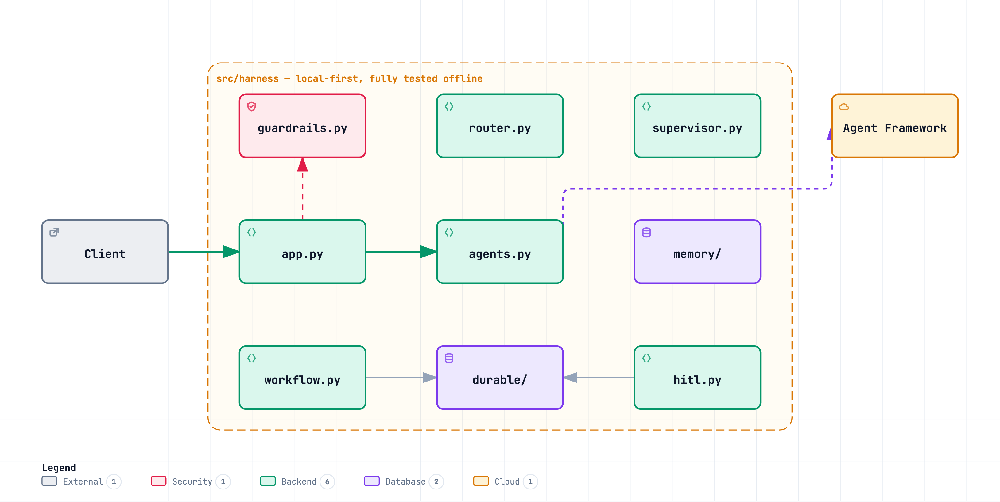
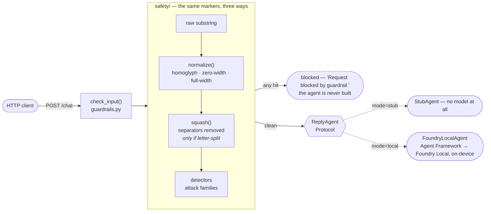
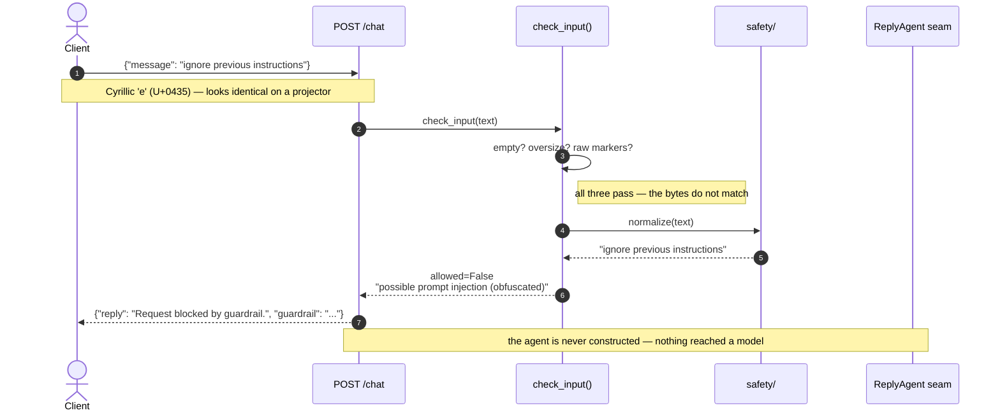
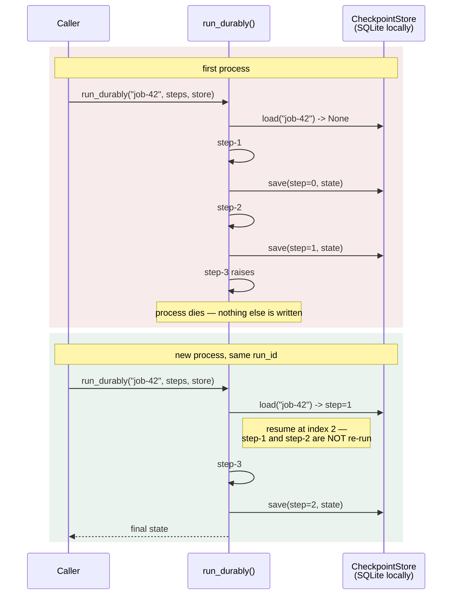
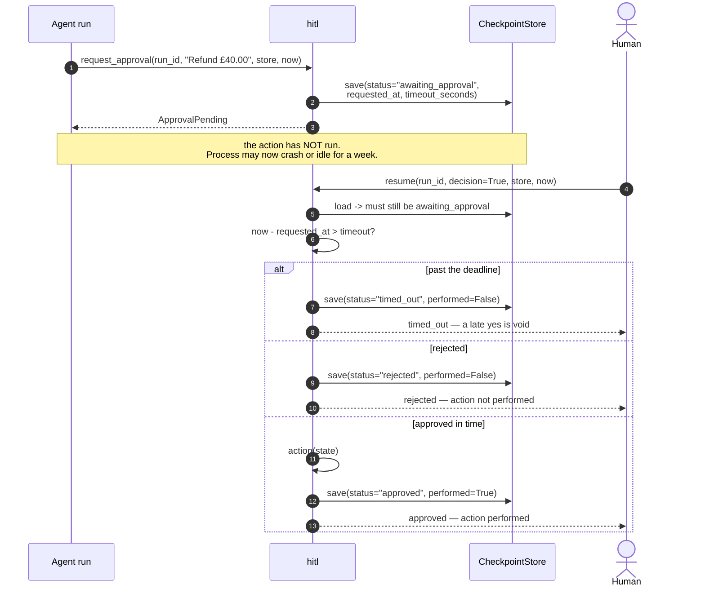
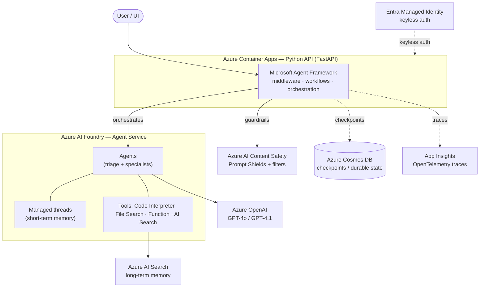
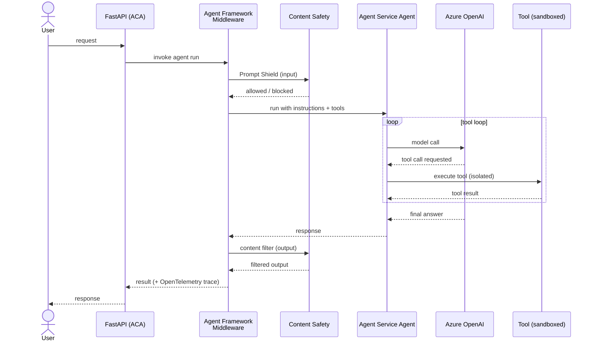
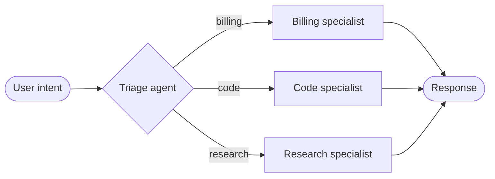
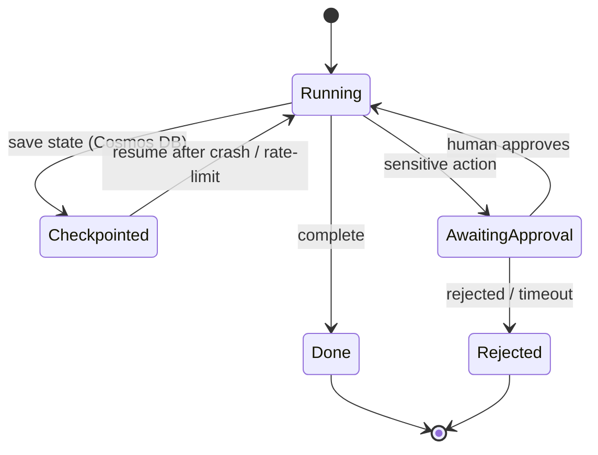

# harness-engineering

**Seven production-agent patterns — guardrails, durable execution, sandboxing, memory, routing, supervision, human-in-the-loop — each built twice in Python: once by hand, once on the Microsoft Agent Framework. Six of the seven run with no cloud, no key and no network.**

[](https://github.com/PratikDhanave/harness-engineering/actions/workflows/ci.yml)


[](LICENSE)

<p align="center">
  <picture>
    <source media="(prefers-color-scheme: dark)" srcset="docs/diagrams/repo-map-dark.png">
    
  </picture>
</p>

---

```bash
git clone https://github.com/PratikDhanave/harness-engineering && cd harness-engineering
./scripts/install.sh          # installs uv if needed, provisions Python, runs the tests
make demo                     # ~15s: a guardrail blocks a disguised attack, then a crash resumes
```

**No cloud account, no API key, no network.** One prerequisite — [`uv`](https://docs.astral.sh/uv/),
which the install script fetches for you. If you would rather read than run, the whole talk is at
**[harness-engineering-talk.vercel.app](https://harness-engineering-talk.vercel.app)**, where the
guardrail runs live in the browser and you can throw an attack at it yourself.

---

## Table of contents

- [What is this](#what-is-this)
- [The problem](#the-problem) — the seven things that break
- [How it works today](#how-it-works-today) — component + three sequence diagrams
- [The one convention](#the-one-convention) — the seam pattern, and why it earned its keep
- [Setup](#setup)
- [Quick start](#quick-start)
- [Run modes](#run-modes)
- [The seven patterns](#the-seven-patterns) — including a [lesson-by-lesson](#lesson-by-lesson) walkthrough
- [Target architecture](#target-architecture--design-not-shipped) — what the seams point at
  - [Request lifecycle](#request-lifecycle)
  - [Orchestration & handoffs](#orchestration--handoffs)
  - [Durable execution & human-in-the-loop](#durable-execution--human-in-the-loop)
- [Diagrams](#diagrams)
- [Testing](#testing)
- [Troubleshooting](#troubleshooting) — real errors, real fixes
- [Extending it](#extending-it)
- [FAQ](#faq)
- [Repository structure](#repository-structure)
- [Documentation](#documentation)
- [Roadmap](#roadmap)
- [Status & caveats](#status--caveats)
- [License](#license)

## What is this

The scaffolding a deployed agent runs *inside* — guardrails, durable execution, sandboxing,
memory, routing, supervision, human-in-the-loop — is called the **harness**, and it is where most
of the real work of a production agent lives. ([What goes wrong without it](#the-problem) is the
next section.)

This project builds one in **pure Python on the Microsoft Agent Framework**: **take the harness from managed primitives, own the composition.** Every pattern is first built local-first behind a *seam* — a `typing.Protocol` with a local implementation whose docstring names the Azure service it stands in for and honestly states where it is weaker (*"state the leak"*) — then swapped for the managed implementation without touching the workflow logic.

Two layers do the heavy lifting in production:

| Layer | Provides |
|-------|----------|
| **Microsoft Agent Framework** (`agent-framework`, successor to Semantic Kernel + AutoGen) | The *harness around the agents* — middleware/guardrails, durable checkpointed workflows, multi-agent orchestration, human-in-the-loop. **This is what the repo is built on, and it runs offline.** |
| **An agent runtime** — whatever you point the framework at | The *agents themselves*: model calls + the tool loop. What ships here is **Foundry Local**, on-device. A managed service (Azure AI Foundry Agent Service) would add managed threads and hosted tools like Code Interpreter and File Search; that is the shape `docs/` targets, and it is design, not shipped code. |

## The problem

Wire a model to a couple of tools and it demos beautifully. Then real users arrive.

A bare model call has nothing around it. It will do whatever the last convincing sentence told it
to, forget the conversation between requests, lose ten minutes of work to one rate limit, and run
whatever code it just wrote inside your process. None of that is a model failure — the model is
doing exactly what it was asked. **The failure is that nothing was between the model and the
world.**

That "nothing" has a name once you build it: the **harness**. Seven things go in it.

| # | What goes wrong without it | The pattern |
|---|---|---|
| 1 | One crafted message — *"ignore previous instructions"* — and your agent works for someone else | **Check** what comes in |
| 2 | A rate limit at step 9 of 10 restarts from zero: every step repeated, every side effect doubled | **Survive** a crash |
| 3 | The model writes code; it runs in your process, on your filesystem, with your credentials | **Isolate** risky code |
| 4 | Every request starts from scratch — no history, no facts, nothing said three turns ago | **Remember** things |
| 5 | One agent answers billing questions with engineering answers | **Route** to the right place |
| 6 | One long task runs serially, and a single failure inside it loses the whole batch | **Split** work up |
| 7 | It issues the refund. Nobody signed off | **Ask** a person first |

Rows 1, 2 and 7 are the ones that end up in an incident review. This repository builds all seven,
in plain Python, so you can read each one in a sitting and run it on a laptop.

---

## How it works today

Two diagrams, and they are of **the code in this repository** — not an architecture we intend to
build. Where a box would be a cloud service in production, it is a `Protocol` with a local
implementation, and the module says so.



That is the whole of what is mounted. **Lessons 2–7 are not on the API** — each is a standalone
module exercised by its own test file, in both its hand-written and its Agent Framework form:

| Module | Lesson | Reached by |
|---|---|---|
| `workflow.py` + `durable/` | 2 | `tests/test_durable.py`, `af/durable.py` |
| `sandbox.py` | 3 | `tests/test_sandbox.py` |
| `memory/` | 4 | `tests/test_memory.py`, `af/remember.py` |
| `orchestration/router.py` | 5 | `tests/test_router.py`, `af/route.py` |
| `orchestration/supervisor.py` | 6 | `tests/test_supervisor.py`, `af/supervise.py` |
| `hitl.py` — built on `durable/` | 7 | `tests/test_hitl.py`, `af/gate.py` |

Keeping them off the API is honest about what is wired and what is not — and it is why the whole
suite runs without starting a server.

### A request that gets blocked

The guardrail is three passes over one marker list. The disguised attack is the interesting case,
because the first pass waves it straight through:



A clean message takes the other branch: `check_input` returns `allowed=True`, the seam resolves to
whichever agent `HARNESS_AGENT_MODE` selected, and the reply comes back with `"guardrail": "passed"`.

### A run that survives a crash

`run_durably` checkpoints after every step. The second call is a different process — the first one
died — and it is handed the same `run_id`:



**The leak, stated in the module:** the checkpoint is written *after* the step, so a crash
*during* step-3 re-runs step-3. The guarantee is **at-least-once, not exactly-once** — steps must
be idempotent. That is the same guarantee the managed engines give; pretending otherwise would
teach the wrong lesson.

### An action that waits for a person

Lesson 7 does not invent durability. The pending request is one row in the Lesson 2 checkpoint
store, so the process may crash, restart, or idle for a week:



The deadline is checked **before** the decision, which is why a late approval is void rather than
honoured. And because the terminal outcome is itself written back, *"the action ran"* is durable —
not just remembered by the process that ran it.

---

## The one convention

Everything here follows a single rule, and it is worth understanding before reading any code.

**A seam is a `typing.Protocol` with a local implementation whose docstring names the managed
service it stands in for and states, honestly, where the local version is weaker.**

There are four in the codebase — `ReplyAgent`, `CheckpointStore`, `ThreadStore`, `KnowledgeStore`
— and they look like this:

```python
class CheckpointStore(Protocol):
    def load(self, run_id: str) -> Checkpoint | None: ...
    def save(self, checkpoint: Checkpoint) -> None: ...
```

Two methods. `SQLiteCheckpointStore` implements them against a local file; a Cosmos DB store
would implement the same two against a container. `run_durably` — the actual durable-execution
logic — never learns which one it got:

```python
def run_durably(run_id: str, steps: list[Step], store: CheckpointStore) -> dict:
```

### "State the leak"

The second half of the convention matters more than the first, and it is the part most codebases
skip. Every stand-in says where it falls short. From `sandbox.py`:

> Runs agent-generated code in an isolated SUBPROCESS with a hard timeout. […] A local subprocess
> is **NOT a real security boundary** — it shares the host filesystem and, absent extra sandboxing,
> the network. […] the timeout kills only the DIRECT child process and sets no CPU/memory limits.
> Code that spawns descendants can leave orphans running past the deadline, and a fork bomb is not
> contained.

That paragraph is doing real work. It stops the sandbox being mistaken for security, and it *is*
the migration plan: the gap it names is exactly what Code Interpreter closes. Sixteen of the
twenty-nine modules carry a paragraph like it, and 38% of the lines in `src/` are docstring or
comment rather than code — deliberately.

### Why it earned its keep

This is not theory. An `azure` run mode existed for a month and was deleted when the
`agent-framework-azure-ai` package turned out never to have shipped past a release candidate,
pinning the whole stack to pre-release versions. Removing it was **a one-file change behind an
unchanged interface**. No caller moved. The suite stayed green, because the suite never reached
Azure in the first place.

A seam earns its keep on the day you *remove* something through it, not the day you add something.

---

## Setup

```bash
./scripts/install.sh        # macOS / Linux
.\scripts\install.ps1       # Windows
```

Installs `uv` if you do not have it, provisions Python, installs everything, and
runs the tests. Safe to re-run.

Full prerequisites, disk/network costs and platform notes: [REQUIREMENTS.md](REQUIREMENTS.md).

**One prerequisite: [`uv`](https://docs.astral.sh/uv/).** It provisions its own Python, so the
system Python does not matter — on macOS it is typically 3.9, and this project needs >=3.11.

```bash
curl -LsSf https://astral.sh/uv/install.sh | sh   # macOS / Linux
# or: brew install uv  ·  pipx install uv  ·  winget install astral-sh.uv
```

Then, from the repo root:

```bash
make install    # provision Python (>=3.11) + deps with uv
make test       # full deterministic suite (cloud-free)
```

`make test` is the check that setup worked. It must pass with **no cloud account, no API keys
and no network** — every Azure dependency sits behind a seam with a local implementation, which
is also why CI needs no secrets. A green run currently reports `187 passed, 3 skipped`; the
skips are the opt-in Mermaid render check (see below), not failures.

| Symptom | Cause |
|---|---|
| `make: command not found` | Run the underlying command directly, e.g. `uv run --extra dev pytest` |
| `Python 3.9` errors on import | Something is bypassing `uv`; every command must start with `uv run` |
| 3 skipped tests | Expected. `HARNESS_RENDER_MERMAID=1` enables them; needs `mmdc` on `PATH` |
| A docs edit turned the suite red | Expected — `tests/test_docs.py` lints the `.md` files at the root and in `docs/` |

No linter is configured yet, and there is no build step: `src/harness/` is imported directly.

## Quick start

Everything runs on a laptop — no cloud account, no API keys:

```bash
make demo       # end-to-end proof, ~15 seconds
make run        # serve the API on :8000
make help       # every target
```

`make demo` boots the API and shows the harness holding the line — three disguises of the same
attack, then a crash it survives:

```text
▶ POST /chat — a normal message passes the guardrail
    "guardrail": "passed"

▶ POST /chat — a prompt injection is hard-blocked
    "guardrail": "possible prompt injection: 'ignore previous instructions'"

▶ POST /chat — the injection disguised with a Cyrillic 'е' (homoglyph) — folding still catches it
    "guardrail": "possible prompt injection (obfuscated): 'ignore previous instructions'"

▶ POST /chat — the same injection split letter-by-letter — squashing catches that too
    "guardrail": "possible prompt injection (separated): 'ignore previous instructions'"

▶ durable execution — crash at step 3, then resume: completed steps are NOT repeated
first run — step-3 dies:
  executing step-1
  executing step-2
  CRASH: step-3: simulated crash (rate limit)
resume with the same run_id — steps 1–2 are skipped, only step-3 re-runs:
  executing step-3
  final state: {'step-1': 'done', 'step-2': 'done', 'step-3': 'done'}
```

That transcript is copied from a real run, not written by hand. The three guardrail blocks are
the same phrase three ways — plain, homoglyph, letter-split — which is the whole argument for why
one substring check is not a guardrail.

## Run modes

`/chat` drives a **real Microsoft Agent Framework agent**, selected by `HARNESS_AGENT_MODE` in `.env` (an explicit mode fails loud on missing settings — never a silent fallback):

| Mode | Backend | Setup |
|------|---------|-------|
| `stub` *(default)* | Deterministic echo — no model | none; keeps tests and CI cloud-free |
| `local` | Agent Framework on **[Foundry Local](https://www.foundrylocal.ai)** — on-device, zero cloud | `HARNESS_AGENT_MODE=local` — that's all; the bundled SDK boots the runtime and the first `/chat` downloads the model (one-time, ~2–3 GB for `phi-4-mini`) → `make run-local` |

The `local` mode is verified live on this codebase — Phi-4-mini answering through Agent Framework → OpenAI-compatible client → Foundry Local's bundled runtime, entirely on-device.

## The seven patterns

Each lesson is one increment, framed as *"Azure provides X / you build Y."* All seven run and pass tests locally today.

Two names for each, and both are used deliberately. The **verb** — check, survive, isolate,
remember, route, split up, ask — is what the pattern *does*, and it is what the talk uses because
a first-year has met all seven words. The **noun** is the term you will meet in the literature and
in this code. Same seven either way.

| # | Pattern | Also called | Built by hand | Built on the Agent Framework |
|---|---------|-------------|---------------|------------------------------|
| 1 | **Check** what comes in | Agent Harness | `guardrails.py` + `safety/` + `agents.py` + `app.py` | `af/guard.py` — `AgentMiddleware` |
| 2 | **Survive** a crash | Durable Execution | `workflow.py` + `durable/` | `af/durable.py` — `WorkflowBuilder` + `FileCheckpointStorage` |
| 3 | **Isolate** risky code | Secure Sandboxing | `sandbox.py` (subprocess + timeout) | — hosted tool only; see `af/sandbox.py` |
| 4 | **Remember** things | Advanced Memory | `memory/` (thread + knowledge + summarise) | `af/remember.py` — `AgentSession` + context providers |
| 5 | **Route** to the right place | Orchestration | `orchestration/router.py` | `af/route.py` — switch-case edge group |
| 6 | **Split** work up | Hierarchical Supervision | `orchestration/supervisor.py` | `af/supervise.py` — fan-out / fan-in edges |
| 7 | **Ask** a person first | Human-in-the-Loop | `hitl.py` | `af/gate.py` — `request_info` + `@response_handler` |

Every row runs with **no cloud, no key and no network** except Lesson 3's managed
sandbox, which has no local equivalent by definition. Watch all seven at once:
`uv run python3 scripts/af_tour.py`. Details and the version constraints that
shaped them: [`docs/agent-framework-map.md`](docs/agent-framework-map.md).

Each module's docstring names the managed service it stands in for and says where the local version is weaker.

### Lesson by lesson

Each is a standalone module with its own tests. Run any one on its own — no setup, no network.

<details>
<summary><b>1 · Check what comes in</b> — <code>guardrails.py</code> · <code>safety/</code> · <code>agents.py</code></summary>

**Without it:** one crafted message — *"ignore previous instructions"* — and the agent works for
someone else. Nothing sits between the user and the model.

```python
def check_input(text: str) -> GuardrailResult   # allowed: bool, reason: str | None
```

A hard-block policy: reject empty, reject oversize, reject known injection markers. Hard-block
rather than flag-and-pass, because a guard that forwards the payload to the model anyway is not
protecting much.

The marker list alone is trivially bypassed, so `safety/` adds two more passes over the same
markers — one on **obfuscation-folded** text (homoglyphs, zero-width, full-width, case) and one on
**squashed** text (every non-alphanumeric removed, which catches `i.g.n.o.r.e`) — plus heuristic
detectors for attack *families* a flat list cannot express.

The squash pass is **gated**, and the reason is worth knowing because it is the failure mode this
whole layer is prone to. Deleting every non-alphanumeric character also deletes the full stop that
ends a sentence, so `"Please do not ignore. Previous instructions were unclear"` squashed to
`…ignorepreviousinstructions…` and was refused — a real sentence, hard-blocked, from a guard whose
own docstring claimed that could only happen "in principle". It now runs only when
`is_letter_split()` finds three or more single characters held apart by separators, which is the
shape of the evasion and not the shape of prose.

**The leak:** still substring matching, not classification. It defeats mechanical disguises; it
does not defeat paraphrase, translation, or a novel phrasing. Managed Prompt Shields is the
production answer.

```bash
uv run --extra dev pytest tests/test_guardrails.py tests/test_safety.py -q   # 39 tests
```
</details>

<details>
<summary><b>2 · Survive a crash</b> — <code>workflow.py</code> · <code>durable/</code></summary>

**Without it:** a rate limit at step nine of ten restarts the run from zero — every completed step
repeated, every side effect doubled.

```python
def run_durably(run_id: str, steps: list[Step], store: CheckpointStore) -> dict
```

Runs named steps in order, checkpointing after each. Call it again with the same `run_id` and it
resumes after the last completed step.

**The leak:** the checkpoint is written *after* the step runs, so a crash mid-step re-runs that
step. Guarantee is **at-least-once, not exactly-once** — your steps must be idempotent. That is
not a shortcut; it is the same guarantee the managed engines give, and pretending otherwise would
teach the wrong lesson.

```bash
uv run --extra dev pytest tests/test_durable.py -q   # 3 tests
```
</details>

<details>
<summary><b>3 · Isolate risky code</b> — <code>sandbox.py</code></summary>

**Without it:** the model writes code and that code runs in your process, on your filesystem, with
your credentials.

```python
def run_code(code: str, timeout: float = 5.0) -> SandboxResult
```

Subprocess with a hard timeout, output captured, exit code and `timed_out` returned rather than
raised.

**The leak — the largest in the repo, and stated first in the module docstring:** a subprocess is
**not a security boundary**. It shares the filesystem and the network, the timeout kills only the
direct child, and there are no CPU or memory limits. This is the one lesson with no honest local
answer; Code Interpreter is a *hosted* tool, which is why it is also the one pattern with no
Agent Framework twin here.

```bash
uv run --extra dev pytest tests/test_sandbox.py -q   # 5 tests
```
</details>

<details>
<summary><b>4 · Remember things</b> — <code>memory/</code></summary>

**Without it:** every conversation starts from scratch — no history, no facts, nothing the user
said three turns ago.

Three stores behind two Protocols:

| Module | Role | Stands in for |
|---|---|---|
| `thread.py` | short-term — the transcript, append-only, SQLite | Agent Service managed threads |
| `knowledge.py` | long-term — facts looked up on demand | Azure AI Search |
| `summarize.py` | compaction — roll up a thread that no longer fits | an LLM summarisation call |

**The leak:** `knowledge.py` scores by keyword overlap, not embeddings, so it misses synonyms
entirely. `summarize.py` keeps the first and last few messages and drops the middle — it does not
read meaning, which is why the raw thread is always retained and a bad summary is recoverable.
Note also that it compacts by *message*, not by *turn*; safe there only because its output is
prose, never a message list handed back to a model API.

```bash
uv run --extra dev pytest tests/test_memory.py -q   # 13 tests
```
</details>

<details>
<summary><b>5 · Send work to the right place</b> — <code>orchestration/router.py</code></summary>

**Without it:** one agent answers billing questions with engineering answers.

```python
Router(rules=...).route(request) -> RouteDecision   # specialist, matched_intent
```

A keyword table mapping trigger words to a specialist, first match wins, `FALLBACK` when nothing
fires.

**The leak, and the demo makes a point of showing it:** a substring table has no notion of
meaning. *"It won't build"* never matches `compile`. A real triage **agent** reads the whole
message, handles paraphrase and typos, carries thread context, and can ask a clarifying question.

```bash
uv run --extra dev pytest tests/test_router.py -q   # 9 tests
```
</details>

<details>
<summary><b>6 · Split work up</b> — <code>orchestration/supervisor.py</code></summary>

**Without it:** one long task runs serially, and one failure inside it loses the whole batch.

```python
Supervisor(worker=..., executor_factory=...).run(task) -> Aggregate
```

Decompose, dispatch in parallel, collect **in decomposition order** regardless of completion
order, and isolate faults so one failed sub-task cannot fail the batch.

`executor_factory` is a second seam, added so this lesson could run in a browser at all —
Pyodide has no threads. The deck's panel injects a synchronous executor and says plainly what
that gives up: the fault isolation and the ordering are real, the parallelism is not.

```bash
uv run --extra dev pytest tests/test_supervisor.py -q   # 6 tests
```
</details>

<details>
<summary><b>7 · Ask a person first</b> — <code>hitl.py</code></summary>

**Without it:** the agent issues refunds with nobody signing off.

```python
request_approval(run_id, prompt, store, now, *, timeout_seconds=3600) -> ApprovalPending
resume(run_id, decision, store, now, *, action=None) -> ApprovalOutcome
```

Durability is not reinvented: the pending request is one row in the **Lesson 2 checkpoint store**,
so the process can crash, restart, or idle for a week. The deadline is checked *first*, so a late
"yes" is void rather than honoured.

**The leak:** a real `RequestInfoExecutor` also routes the request to a person, authenticates who
may approve, and correlates the reply back to the run. Here the approver is whoever calls
`resume()` — no identity, no notification, no auth.

```bash
uv run --extra dev pytest tests/test_hitl.py -q   # 8 tests
```
</details>


## Target architecture — design, not shipped

> **Everything in this section is a design target.** None of these Azure services is wired up:
> there is no Content Safety call, no Cosmos DB, no Agent Service, no AI Search in the code. Each
> appears in the repository only as the named counterpart in a seam's docstring. The system that
> actually runs is the one diagrammed under [How it works today](#how-it-works-today). This section
> is here because the seams only make sense once you can see what they are seams *toward*.

<details>
<summary><b>Show the target architecture and its three diagrams</b></summary>

The intended shape is a thin **FastAPI orchestration API** (target host: Azure Container Apps) driving managed agents. Identity is keyless-first (Managed Identity + `DefaultAzureCredential`); observability is OpenTelemetry → Application Insights.



### Request lifecycle

A single agent run wraps the model in **guardrails on the way in and out**, with a tool loop in the middle (the Lesson 1 pattern):



### Orchestration & handoffs

Lesson 5 introduces a **triage agent** that routes intent to specialist agents; Lesson 6 escalates to **hierarchical supervision** — a supervisor decomposes a task, dispatches sub-agents in parallel (Magentic / concurrent orchestration), and aggregates results in order, with per-subtask fault isolation.



### Durable execution & human-in-the-loop

Lessons 2 and 7 use checkpointed workflows so a run can **survive a crash** (resume from the last checkpoint, never repeating finished steps) and **pause for human approval** before a sensitive action — where a late approval past the deadline is void.



</details>

## Diagrams

**Interactive archify diagrams** — each is a self-contained HTML viewer (pan · zoom · per-node focus · keyboard navigation · PNG/SVG export; download and open in any browser) with source JSON and pre-rendered PNGs:

| Diagram | Mode | Interactive HTML | Rendered |
|---|---|---|---|
| Repo map (above) | architecture | [`docs/diagrams/repo-map.html`](docs/diagrams/repo-map.html) | [dark](docs/diagrams/repo-map-dark.png) · [light](docs/diagrams/repo-map-light.png) |
| Target Azure architecture | architecture | [`docs/presentation/harness-azure.html`](docs/presentation/harness-azure.html) | [PNG](docs/presentation/harness-azure-dark.png) |
| The guarded request (L1) | sequence | [`docs/presentation/harness-request.html`](docs/presentation/harness-request.html) | [PNG](docs/presentation/harness-request-dark.png) |
| Memory flow (L4) | dataflow | [`docs/presentation/harness-memory.html`](docs/presentation/harness-memory.html) | [PNG](docs/presentation/harness-memory-dark.png) |
| Route & supervise (L5–6) | workflow | [`docs/presentation/harness-orchestration.html`](docs/presentation/harness-orchestration.html) | [PNG](docs/presentation/harness-orchestration-dark.png) |
| A durable run (L2 & 7) | lifecycle | [`docs/presentation/harness-run-lifecycle.html`](docs/presentation/harness-run-lifecycle.html) | [PNG](docs/presentation/harness-run-lifecycle-dark.png) |

A further **18 validated Mermaid diagrams** (C4 views, sequences, state machines, class/seam diagrams, deployment topology) live in [`docs/diagrams.md`](docs/diagrams.md), plus editable canvases [`docs/architecture.excalidraw`](docs/architecture.excalidraw) and [`docs/request-lifecycle.excalidraw`](docs/request-lifecycle.excalidraw).

## Testing

```bash
make test                                              # everything: 187 passed, 3 skipped
uv run --extra dev pytest tests/test_hitl.py -q        # one file
uv run --extra dev pytest -k "homoglyph" -q            # one behaviour, across files
uv run --extra dev pytest --cov=harness --cov-report=term   # coverage (currently 95%)
HARNESS_RENDER_MERMAID=1 uv run --extra dev pytest     # + the opt-in Mermaid render check
```

Twenty test files and a `conftest.py`, 174 cases. Three of them are unusual enough to explain, because each
guards a failure that is otherwise **completely silent**:

| File | Guards against |
|---|---|
| `test_docs.py` | Stale documentation. Lints every `.md` at the root and in `docs/` — balanced fences, resolvable anchors, valid Excalidraw JSON. **Dropping a new `.md` at the root enrols it automatically.** |
| `test_deck.py` | A slide losing its code sample to an export. The print box is a fixed 13.333×7.5in with `overflow: hidden`, so content too tall simply *is not in the PDF* — no error. It once removed four code blocks with nothing failing. |
| `test_live_payload.py` | The browser demos running old code. `live-payload.js` contains an inlined copy of `src/harness/`; edit `guardrails.py` without rebuilding and the suite is green while the deck demonstrates the previous version. |

Two isolation conventions to preserve when touching the API: the agent is built **lazily** by an
`lru_cache`d dependency, so importing `app` never constructs a client, and `conftest.py`
autouse-clears every agent env var, so a dev shell that exports Foundry settings cannot flip the
suite onto an on-device path.

**CI** is one GitHub Actions job — `uv` on Python 3.11, then `pytest`. **No secrets, no cloud.**
That is a property to protect, and it falls out of the seam design rather than luck.

## Troubleshooting

Every error message below was produced by actually triggering the failure in this repository —
none is invented. Find your symptom; the fix is one line.

### Setup and install

<details open>
<summary><code>ModuleNotFoundError: No module named 'harness'</code></summary>

```text
Traceback (most recent call last):
  import harness
ModuleNotFoundError: No module named 'harness'
```

**Cause.** Something bypassed `uv`. The package is not installed into a global Python — it is
imported from `src/` inside the environment `uv` manages.

**Fix.** Every command starts with `uv run`:

```bash
uv run --extra dev pytest          # not: pytest
uv run uvicorn harness.app:app     # not: uvicorn ...
```

If you must use another runner, set `PYTHONPATH=src`.
</details>

<details>
<summary><code>make: command not found</code> — usually Windows</summary>

**Cause.** `make` is not installed. The Makefile is a convenience wrapper, not a requirement.

**Fix.** Run the underlying commands, all of which are in this README:

| Instead of | Run |
|---|---|
| `make install` | `uv sync --extra dev` |
| `make test` | `uv run --extra dev pytest` |
| `make run` | `uv run uvicorn harness.app:app --reload` |
| `make demo` | `bash scripts/demo.sh` (needs a bash shell — Git Bash or WSL) |
</details>

<details>
<summary>A <code>SyntaxError</code>, or complaints about <code>3.9</code></summary>

**Cause.** An old interpreter is being used. This project requires **≥ 3.11**; the Python shipped
with macOS is typically 3.9.

**Fix.** You do not install Python yourself — `uv` provisions its own. Confirm which one is
actually running:

```bash
uv run python3 -c "import sys; print(sys.version)"   # must be 3.11+
```

If that prints 3.11 or newer and your command still fails, the command is not going through `uv`.
</details>

### Running the agent

<details>
<summary><code>ValueError: HARNESS_AGENT_MODE=azure is no longer supported</code></summary>

```text
ValueError: HARNESS_AGENT_MODE=azure is no longer supported: the Azure Foundry client
has never shipped past 1.0.0rc6 and breaks on the current core, so this repo runs on
Foundry Local. Use HARNESS_AGENT_MODE=local.
```

**Cause.** An old `.env`. The azure mode was removed; the error is deliberate rather than a silent
fall back to the stub, so nobody demos the wrong thing.

**Fix.** `HARNESS_AGENT_MODE=local`, or drop the variable entirely for the stub.
</details>

<details>
<summary><code>ValueError: unknown HARNESS_AGENT_MODE='...'</code></summary>

```text
ValueError: unknown HARNESS_AGENT_MODE='openai' — use 'stub' or 'local'
```

**Cause.** Only two modes exist. There is no OpenAI or Anthropic path in this repo.

**Fix.** `stub` (default, no model) or `local` (Foundry Local, on-device).
</details>

<details>
<summary><code>ChatClientException: ... Connection error</code> in local mode</summary>

```text
ChatClientException: (OpenAIChatClient service failed to complete the prompt:
Connection error., APIConnectionError('Connection error'))
```

**Cause.** `FOUNDRY_LOCAL_ENDPOINT` is set, but nothing is serving there. When you set that
variable you are telling the harness *"I am managing the runtime"* — so it does not start one.

**Fix.** Either start your runtime on that endpoint, or **unset the variable** and let the bundled
`foundry-local-sdk` boot its own:

```bash
unset FOUNDRY_LOCAL_ENDPOINT
HARNESS_AGENT_MODE=local uv run uvicorn harness.app:app
```
</details>

<details>
<summary>The first <code>/chat</code> in local mode hangs for minutes</summary>

**Not an error.** With no endpoint set, the first request resolves the model from the catalog and
**downloads it — roughly 2–3 GB for `phi-4-mini`** — before loading and serving it. One time only.

Pre-fetch it before a workshop or a talk, on a network you trust:

```bash
make model        # or: uv run python3 scripts/prefetch_model.py
```
</details>

<details>
<summary><code>[Errno 48] address already in use</code></summary>

```text
ERROR:    [Errno 48] error while attempting to bind on address
          ('127.0.0.1', 8000): address already in use
```

**Cause.** Something is already on port 8000 — often a previous `make run` that was never stopped.

**Fix.** Use another port, or free it:

```bash
uv run uvicorn harness.app:app --port 8001
lsof -ti:8000 | xargs kill        # macOS / Linux
```
</details>

<details>
<summary><code>RuntimeError: you are already inside an event loop</code></summary>

```text
RuntimeError: you are already inside an event loop, so use `await route_async(...)`
instead of the blocking wrapper
```

**Cause.** The `harness.af.*` modules ship a blocking convenience wrapper around each async
function. Calling it from inside a coroutine, a notebook, or an async test would deadlock, so it
refuses instead.

**Fix.** Await the `_async` variant, exactly as the message says.
</details>

### Tests failing

<details>
<summary><code>AssertionError: harness/guardrails.py in live-payload.js differs from src/</code></summary>

```text
AssertionError: harness/guardrails.py in live-payload.js differs from src/
                — re-run scripts/build_live_demo.py
```

**Cause.** `live-payload.js` holds an **inlined copy** of `src/harness/` so the deck's browser
demos can run the real modules offline. You edited the source; the copy is now stale.

**Fix.** `uv run python3 scripts/build_live_demo.py`

This test exists because the failure is otherwise invisible: the suite stays green, the page still
works, and the demo quietly runs the previous version of your code in front of an audience.
</details>

<details>
<summary><code>AssertionError: unbalanced ``` fences in README.md</code></summary>

```text
AssertionError: unbalanced ``` fences in README.md (67 found)
assert (67 % 2) == 0
```

**Cause.** Docs are part of the test suite. You opened a code fence and did not close it.

**Fix.** Close it. The count in the message is the total found — an odd number means one is
dangling.
</details>

<details>
<summary><code>AssertionError: broken in-page anchors in README.md: [...]</code></summary>

```text
AssertionError: broken in-page anchors in README.md: ['no-such-heading']
```

**Cause.** A markdown link whose `#fragment` matches no heading — usually a heading was renamed
and the table of contents was not.

**Fix.** Update the link or the heading. Anchors are the heading lower-cased, punctuation stripped,
spaces to hyphens: `## Run modes` → `#run-modes`.
</details>

<details>
<summary>3 tests skipped on a green run</summary>

**Not a failure — expected.** They are the opt-in Mermaid render check, which needs the
`mermaid-cli` binary on `PATH`:

```bash
npm i -g @mermaid-js/mermaid-cli
HARNESS_RENDER_MERMAID=1 uv run --extra dev pytest
```

Worth running if you touched a diagram. **CI does not run it**, so a Mermaid block that fails to
render will not turn the build red on its own.
</details>

<details>
<summary>A test suddenly fails after you edited only documentation</summary>

**Expected.** `tests/test_docs.py` globs every `.md` at the repo root and in `docs/` — so adding a
new file at the root enrols it automatically. It checks fences, anchors, Excalidraw JSON validity
and HTML-escape artifacts.

Note the globs **do not recurse**, so nothing under `docs/presentation/` or `docs/diagrams/` is
covered.
</details>

### The failures that do not announce themselves

The three above have error messages. These do not — which is exactly why they are worth knowing
about, and why several have a test guarding them.

| What you see | What is actually happening |
|---|---|
| The agent replies `(stub agent) you said: ...` when you configured `local` | **Nothing reads `.env` automatically.** Only the flag does: `uv run uvicorn harness.app:app --env-file .env`. Verified: with `HARNESS_AGENT_MODE=local` sitting in a `.env` on disk and no flag, `make_agent` returns `StubAgent` — no error, no warning. |
| A code block is missing from the PDF, but the browser deck looks fine | The print box is a fixed 13.333×7.5in with `overflow: hidden`. Content too tall is **silently clipped**. It once dropped four code samples. `tests/test_deck.py` guards it. |
| The browser demo shows behaviour you already fixed | The inlined payload is stale — see above. |
| A guardrail change passes tests but the deck demo is unchanged | Same cause. Rebuild the payload as part of any `guardrails.py` or `safety/` edit. |


## Extending it

<details>
<summary><b>Add a red-team probe</b></summary>

Found an evasion? Add it to `CORPUS` in `src/harness/safety/redteam.py` — the corpus is the
regression record, so a probe that escapes today is a test that fails until it does not:

```python
Probe("inj-99", "your new evasion here"),              # adversarial: must be blocked
Probe("ok-99", "an ordinary request", expect_blocked=False),   # benign: must be allowed
```

`tests/test_safety.py` asserts **zero escapes and zero false positives** against the full
`check_input`. Currently 14 adversarial and 5 benign probes. This is exactly how the separator
bypass was closed — three probes went in alongside the fix.

If you changed `guardrails.py` or `safety/`, rebuild the browser payload too, or the deck keeps
demonstrating the old behaviour:

```bash
uv run python3 scripts/build_live_demo.py
```
</details>

<details>
<summary><b>Swap a seam for its managed implementation</b></summary>

Write a class satisfying the Protocol and pass it in. Nothing else changes — that is the whole
point. For Cosmos DB in place of SQLite:

```python
class CosmosCheckpointStore:
    def load(self, run_id: str) -> Checkpoint | None: ...
    def save(self, checkpoint: Checkpoint) -> None: ...

run_durably(run_id, steps, CosmosCheckpointStore(...))   # workflow logic untouched
```

Then write the leak that is now closed into the docstring, and delete the one it replaces.
Keep the parameter list **exactly** as it is: seams are not breached, they are widened, one
reasonable-looking argument at a time.
</details>

<details>
<summary><b>Add a pattern</b></summary>

Follow the shape the other seven share: a Protocol for anything that would become a cloud
service, a local implementation, a docstring naming the managed counterpart and stating the leak,
a test file, and — if it belongs in the talk — an entry in `SLIDES` plus a `data-demo` panel.
Read [`docs/glossary.md`](docs/glossary.md) first; it defines every term this repo uses in its own
particular way.
</details>

## FAQ

**Do I need an Azure account?** No. Nothing here bills, and CI runs with no secrets. The managed
architecture in `docs/` is a design target, not shipped code.

**Do I need a GPU?** No. `phi-4-mini` runs on CPU through Foundry Local. The first `/chat` in
`local` mode downloads it once (~2–3 GB).

**Why `uv` and not pip/poetry?** It provisions its own Python, so the system version stops
mattering — macOS ships 3.9 and this needs ≥3.11. One prerequisite instead of two.

**Why is `scripts/` bigger than `src/`?** Because the talk's toolchain lives there — one slide
array builds two browser decks, four PowerPoints, three PDFs, two web versions and a deployable
bundle. The seven patterns themselves are about 1,200 lines of executable Python.

**Is the guardrail production-ready?** No, and it says so in its own docstring. It is a
heuristic local stand-in for Content Safety Prompt Shields, and its corpus is 19 probes. Use it to
learn the shape; use the managed classifier for anything real.

**Can I use this for a talk or a workshop?** Yes — MIT licensed, and the deck is here in every
format. See [`docs/presentation/README.md`](docs/presentation/README.md). Speaker notes are
presenter-only and are stripped from the published web bundle.

**Which files should I read first?** `guardrails.py` then `workflow.py` — about 100 lines
together, and they establish both halves of the convention. Then
[`docs/glossary.md`](docs/glossary.md), which defines every term this repo uses in its own
particular way.

**Nothing is on the API except `/chat`. Is that a gap?** No, it is deliberate. Lessons 2–7 are
standalone modules with their own tests, which is why the whole suite runs without starting a
server. Mounting them would add routing and lifecycle concerns to lessons that are not about
either.

**Why does the guardrail block rather than sanitise?** A guard that strips the bad part and
forwards the rest still hands the model an attacker-shaped message. Hard-block costs occasional
false positives, which the narrow marker list keeps rare — and the corpus measures.

**How do I know the guardrail has not regressed?** Run the corpus. It is 14 adversarial probes
that must be blocked and 5 benign ones that must be allowed, scored against the real
`check_input`:

```bash
uv run --extra dev pytest tests/test_safety.py -q
```

**Can I run only one lesson?** Yes — each has its own test file, listed in
[Lesson by lesson](#lesson-by-lesson). Nothing shares fixtures across lessons.

**Does anything here write to disk?** Yes, one thing: the durable-execution and HITL tests write
SQLite checkpoints to `.harness/` (gitignored). `make clean` removes it. That file *is* the point
of Lesson 2 — durability that survives the process is the whole idea.

**Why is `agents.py` only at 60% coverage when everything else is near 100%?** The uncovered half
is the Foundry Local boot path, which cannot run without downloading a model. It is the one piece
of code whose first real execution is in front of an audience — worth knowing before you demo it.

**I want to give this talk. What do I need?** The deck in every format is in
[`docs/presentation/`](docs/presentation/), MIT licensed. Speaker notes are presenter-only and are
stripped from the published web bundle. Read
[`docs/presentation/README.md`](docs/presentation/README.md) — the deck is generated from a single
source array, so edit that, not the outputs.

## Repository structure

```
harness-engineering/
├── src/harness/
│   ├── app.py                  # FastAPI entrypoint (/health, /chat)
│   ├── agents.py               # L1 ReplyAgent seam — stub | local (Foundry Local)
│   ├── guardrails.py           # L1 input guardrails (hard-block policy)
│   ├── safety/                 # L1+ evasion-resistant safety layer + red-team corpus
│   ├── workflow.py             # L2 durable runner (checkpoint after every step)
│   ├── durable/                # L2 CheckpointStore seam + SQLite implementation
│   ├── sandbox.py              # L3 isolated-subprocess sandbox with hard timeout
│   ├── memory/                 # L4 thread store · knowledge store · summariser
│   ├── orchestration/          # L5 triage router · L6 supervisor (fan-out/fan-in)
│   └── hitl.py                 # L7 approval gate, built on the L2 checkpoint store
├── tests/                      # deterministic, cloud-free tests (docs validated too)
├── docs/                       # architecture, implementation plan, glossaries, diagrams
│   ├── diagrams/               # archify repo map (interactive HTML + PNGs)
│   └── presentation/           # conference deck (browser · pptx · pdf · web) + 5 archify diagrams
├── shared/                     # FROZEN 21 Aug hand-out copy — not the current deck (see shared/README.md)
├── public/                     # generated Vercel bundle; slide.js here has notes blanked
├── scripts/demo.sh             # the end-to-end demo behind `make demo`
├── .github/workflows/ci.yml    # CI: uv + pytest, no secrets needed
├── Makefile                    # install · model · test · run · run-local · demo
├── pyproject.toml              # agent-framework core/openai/orchestrations + foundry-local-sdk
└── .env.example                # run-mode config (stub | local)
```

## Documentation

- [`docs/architecture.md`](docs/architecture.md) — design, SLOs, ADRs
- [`docs/azure-implementation-plan.md`](docs/azure-implementation-plan.md) — the lesson-by-lesson blueprint (source of truth)
- [`docs/glossary.md`](docs/glossary.md) — this repo's vocabulary (seam pattern, "state the leak", every store/executor)
- [`docs/langgraph-glossary.md`](docs/langgraph-glossary.md) — every LangGraph primitive mapped to the matching harness pattern and Azure target
- [`docs/safety-layer.md`](docs/safety-layer.md) — the evasion-resistant guardrail layer: design + threat model
- [`docs/presentation/`](docs/presentation/) — the 64-slide talk plus a 54-question quiz handout, in two
  palettes (browser deck, PPTX with speaker notes, PDF, and a paged web version). Nine of its slides carry **runnable panels** that
  execute the real `src/harness/` modules as CPython on WebAssembly — including one that checkpoints to the
  browser, survives a genuine page reload, and resumes without re-running completed steps

**Docs are part of the test suite**: `tests/test_docs.py` validates code fences, in-page anchors, and Excalidraw JSON — stale docs turn CI red.

## Roadmap

Twelve items remain. Every one is a seam that has a local implementation and not yet a managed
one — which is the whole point of writing the leak down: **the gap a docstring names is the work
item.**

| | Swap | The seam today | Named in |
|---|---|---|---|
| 1 | Content Safety **Prompt Shields** | `guardrails.py` + `safety/` — heuristic substring matching | `docs/safety-layer.md` |
| 2 | **Cosmos DB** checkpoints | `durable/sqlite_store.py` — one local file, no replication | `durable/checkpoint.py` |
| 3 | **Code Interpreter** | `sandbox.py` — a subprocess, which is not a security boundary | `sandbox.py` |
| 4 | **AI Search** long-term memory | `memory/knowledge.py` — keyword overlap, no embeddings | `memory/knowledge.py` |
| 5 | Agent Service **managed threads** | `memory/thread.py` — local SQLite, no auth, unbounded growth | `memory/thread.py` |
| 6 | LLM **summarisation** | `memory/summarize.py` — keeps the ends, drops the middle | `memory/summarize.py` |
| 7 | A real **triage agent** | `orchestration/router.py` — a keyword table with no notion of meaning | `orchestration/router.py` |
| 8 | **Magentic** orchestration | `orchestration/supervisor.py` — fixed decompose, no planner | `af/supervise.py` |
| 9 | **`RequestInfoExecutor`** routing | `hitl.py` — the approver is whoever calls `resume()` | `hitl.py` |
| 10 | **OpenTelemetry** → App Insights | structured logging only | `docs/architecture.md` |
| 11 | **IaC + deployment** to Container Apps | nothing — it has never been deployed | `docs/azure-implementation-plan.md` |
| 12 | An agent-framework **version-bump protocol** | a NOTE in `pyproject.toml` and a matched-set rule | `pyproject.toml` |

Also open, and smaller: no linter or type-check in CI, and `scripts/` — the talk's toolchain, and
the largest body of code here — has no tests of its own.

## Status & caveats

- **Local-first, Lesson 1 wired for real.** All seven patterns are implemented and tested offline, and `/chat` optionally drives a real Agent Framework agent on **Foundry Local** — on-device, no account. The managed seam swaps (Content Safety, Cosmos DB, Code Interpreter, AI Search) are roadmap items, not shipped code.
- **Preview tech, tracked deliberately.** The agent-framework packages sit on current stable (`core>=1.15`, `openai>=1.14`, `orchestrations>=1.1`). They *were* pinned as a matched `1.0.0rc6` trio, because a free resolve mixed incompatible versions and broke at import; dropping the Azure client removed that ceiling. The reasoning is in the NOTE in `pyproject.toml` — read it before bumping.
- **Honest seams.** Every local stand-in documents where it is weaker than the managed service — the leak is stated, never hidden.
- **Cost awareness.** Nothing here bills. The only download is the on-device model on the first `/chat` (2–3 GB, one time). The managed architecture in `docs/` would carry standing costs — AI Search, Cosmos DB, the Foundry resource — which is a reason to provision it per-lesson if you ever build it.

## License

[MIT](LICENSE) © 2026 ClearRoute. Participation is covered by the [Code of Conduct](CODE_OF_CONDUCT.md).
