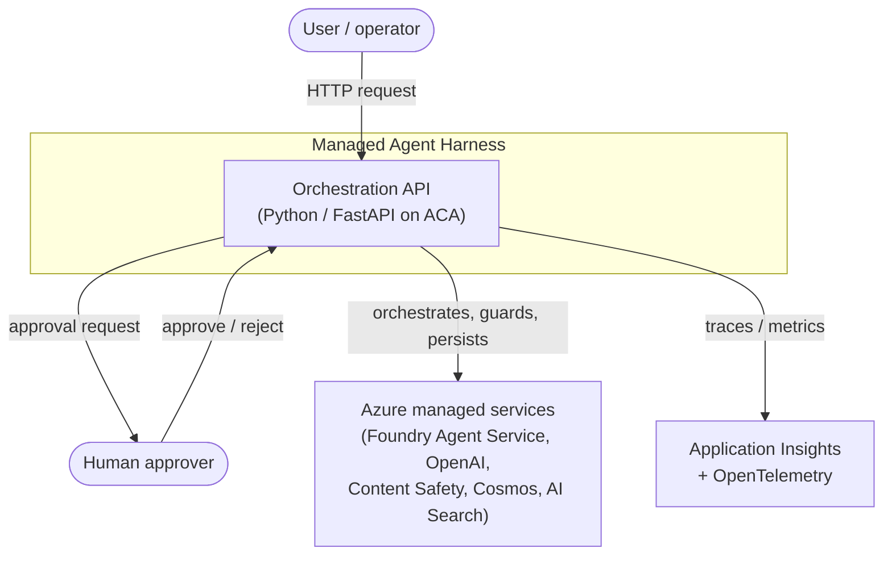
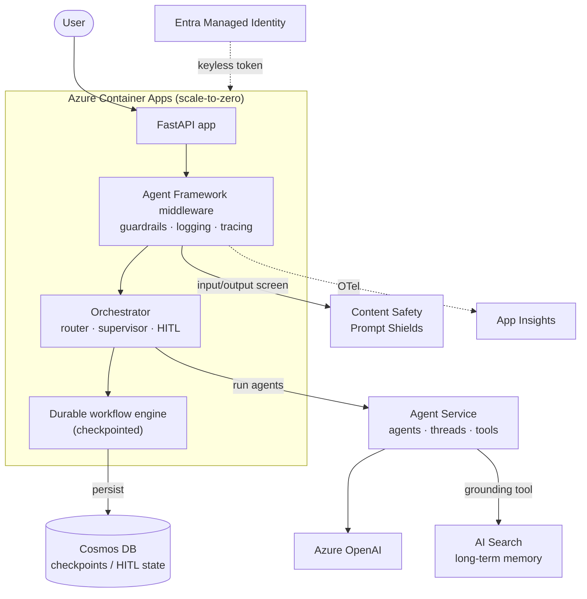
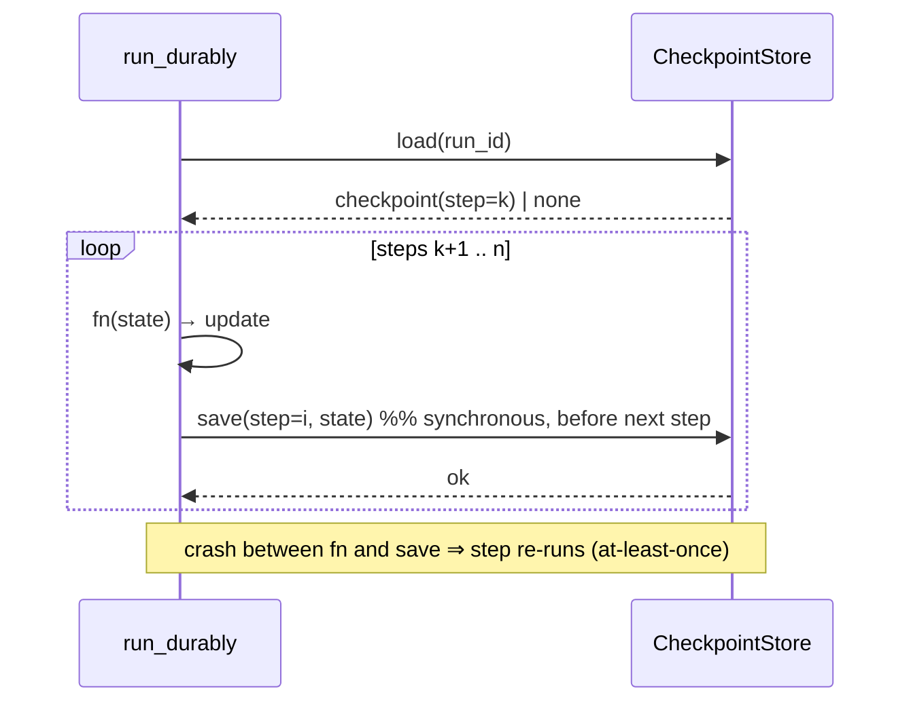
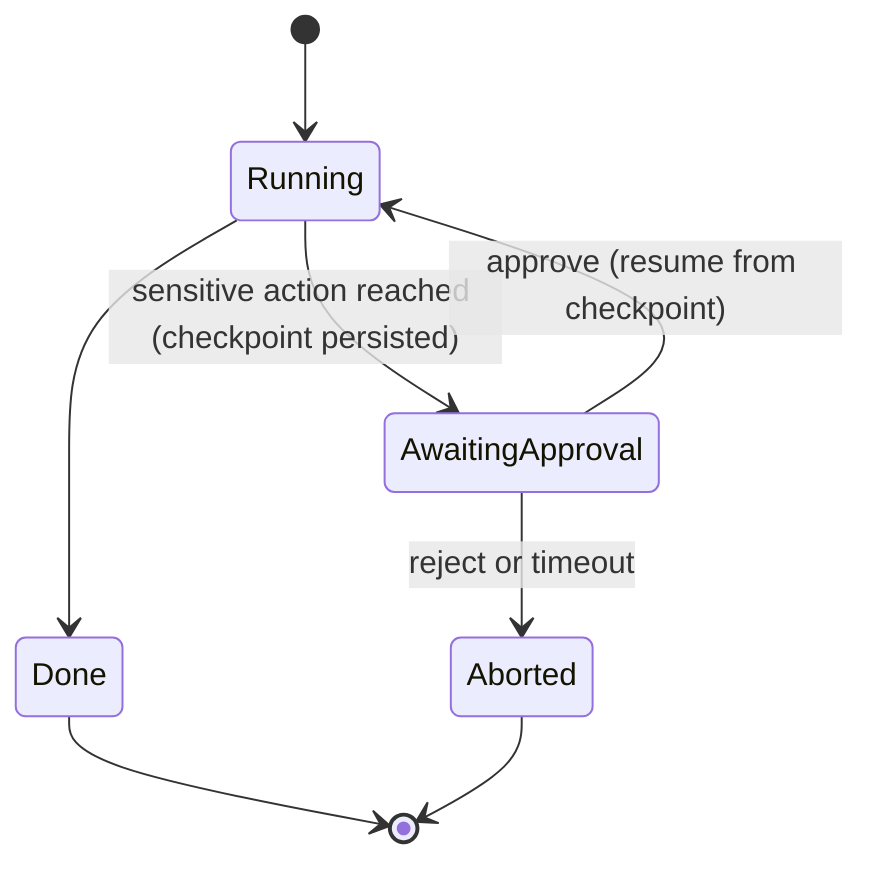

# Architecture — Managed Agent Harness on Azure

| | |
|---|---|
| **Status** | Draft for review (all 7 lessons implemented locally; Lesson 1 /chat wired to Agent Framework, opt-in via env; remaining Azure wiring pending) |
| **Scope** | End-to-end architecture for re-implementing the 7 harness-engineering patterns on Azure with Python |
| **Audience** | Engineers, reviewers, and adversarial readers (human or model) evaluating design soundness |
| **Companion docs** | [`azure-implementation-plan.md`](azure-implementation-plan.md) (lesson plan), [`lesson-02-durable-execution.md`](lesson-02-durable-execution.md) |
| **Non-goals** | A production SaaS; a novel agent framework; multi-cloud portability (see §14 ADR-002) |

> **How to read this doc.** §1–§5 frame the problem and contract. §6–§9 are the design. §10–§13
> are the cross-cutting guarantees (data, correctness, security, reliability, performance, cost).
> §14 records the decisions and the alternatives we rejected. §16 is written specifically to be
> attacked — it states the strongest objections we could find and answers them.

---

## 1. Context & problem statement

Autonomous LLM agents fail in characteristic ways: they lose context, run untrusted generated code,
forget across sessions, crash mid-task and lose all progress, mis-route work, and take irreversible
actions without oversight. Seven patterns address these failure modes.

This project builds those 7 patterns in **pure Python** on the **Microsoft Agent Framework** and
**Azure AI Foundry**, deliberately **taking the harness from managed primitives** instead of
hand-rolling it. The engineering problem is therefore *not*
"how do I build an agent runtime" — it is **"how do I compose managed primitives into a correct,
observable, secure, recoverable agent system, and know where the managed abstractions leak."**

The 7 patterns → the failure they mitigate:

| # | Pattern | Failure mitigated |
|---|---------|-------------------|
| 1 | Agent harness (context + tools + guardrails) | Unbounded/unsafe model I/O |
| 2 | Durable execution | Total progress loss on crash / rate-limit |
| 3 | Secure sandboxing | Untrusted generated code harming the host |
| 4 | Advanced memory | Amnesia across turns and sessions |
| 5 | Orchestration (routing/handoff) | One agent doing everything badly |
| 6 | Hierarchical supervision | No parallel decomposition of large tasks |
| 7 | Human-in-the-loop | Irreversible actions taken without approval |

## 2. Goals & non-goals

**Goals (G):**
- **G1** — Implement all 7 patterns as composable, independently testable components.
- **G2** — Every component runs **locally with no Azure dependency** for fast, deterministic tests,
  and swaps to a managed Azure backend behind a stable interface (the "seam" principle, §11).
- **G3** — Correctness under failure: a crashed run resumes without duplicating committed work.
- **G4** — Defense-in-depth against prompt injection and untrusted code.
- **G5** — Full-fidelity observability (every model call, tool call, token, and decision traced).
- **G6** — Keyless-by-default security posture.

**Non-goals (NG):**
- **NG1** — Production multi-tenant SaaS hardening (rate-limit fairness, quota billing).
- **NG2** — Cloud portability. We optimize for Azure depth over abstraction (§14 ADR-002).
- **NG3** — Building model/inference infrastructure. We consume Azure OpenAI.
- **NG4** — A custom agent framework. We use Microsoft Agent Framework.

## 3. Requirements

### 3.1 Functional
- **F1** Accept a user request, apply input guardrails, run an agent, apply output guardrails, return a result.
- **F2** Persist run progress and resume from the last committed step after a crash.
- **F3** Execute agent-generated code in an isolated sandbox with a hard timeout.
- **F4** Maintain per-conversation short-term memory and a queryable long-term knowledge store; summarize long histories.
- **F5** Route a request to a specialist agent by intent; hand off with context.
- **F6** Decompose a task, dispatch sub-agents in parallel, aggregate results.
- **F7** Suspend before a sensitive action, request human approval, resume or abort on response/timeout.

### 3.2 Non-functional (with explicit SLOs)

> SLO numbers are **design targets to validate**, not measured results. They exist so reviewers can
> check the design against a concrete bar and so load tests have pass/fail criteria. Each is stated
> with its dominating dependency, because an SLO you don't control is a wish.

| ID | Attribute | Target | Dominating dependency / notes |
|----|-----------|--------|-------------------------------|
| N1 | **Harness overhead latency** (everything except model token generation) | p95 < 300 ms, p99 < 600 ms | Our code + guardrail call + checkpoint write. This is what we actually control. |
| N2 | **End-to-end `/chat` latency** (typical short reply) | p95 < 8 s | Dominated by Azure OpenAI generation; not independently controllable. |
| N3 | **API availability** | 99.5% (dev, single region); 99.9% (prod, stretch) | Capped by Azure OpenAI (99.9% SLA) and ACA. Composite availability of a serial chain is the *product* of dependencies — see §16 Q7. |
| N4 | **Durability of committed steps (RPO)** | 0 committed steps lost | Synchronous checkpoint write before a step is acknowledged (§10.2). |
| N5 | **Recovery time (RTO)** | < 30 s from process restart to resume | Restart + load latest checkpoint + continue. |
| N6 | **Sandbox timeout enforcement** | direct-child runaway killed ≤ configured timeout + 1 s | Local: kills the direct child only (descendants/resource-limits NOT contained — see §9.3). Azure: Code Interpreter managed limits. |
| N7 | **Guardrail coverage** | 100% of inbound user text passes an input guard before reaching the model | *Target* enforced via middleware in the Azure design; the local build calls the guard inline in `/chat` (§9.1). |
| N8 | **Trace completeness** | 100% of runs emit an OpenTelemetry trace spanning API→guard→agent→tools | App Insights ingestion. |

### 3.3 Constraints (C) & assumptions (A)
- **C1** Microsoft Agent Framework is **public preview**; APIs shift. Versions must be pinned per lesson.
- **C2** Agent Service tool availability (e.g. Code Interpreter) varies by **region and model**. Region support must be verified before relying on a tool.
- **C3** Cost must stay low for a practice project → prefer scale-to-zero and serverless SKUs.
- **C4** Keyless auth (Managed Identity) preferred; keys only where a service mandates them.
- **A1** Single writer per `run_id` (no concurrent execution of the same run). Enforced by the orchestration layer; see §16 Q3 for the multi-writer extension.
- **A2** Tool side-effects are **idempotent or carry an idempotency key** (required for at-least-once execution — §10.3).
- **A3** Traffic is low-to-moderate (practice scale); this justifies serverless SKUs and shapes §12.

## 4. Architectural tenets

1. **Buy the harness, own the composition.** Managed primitives for undifferentiated heavy lifting; our code is orchestration, guardrails, and glue.
2. **Every managed dependency hides behind a seam.** A `Protocol`/interface with a local implementation and an Azure implementation. This is what makes G2 (local-first) and testability real.
3. **Correctness over convenience under failure.** At-least-once + idempotency, synchronous checkpoints, explicit recovery semantics.
4. **Guardrails are structural, not optional.** Enforced in middleware so no endpoint can bypass them.
5. **Observability is a first-class output, not an afterthought.** If a decision isn't traced, it didn't happen.
6. **State the leak.** Where a managed abstraction is weak (preview API, region gaps, fake-local security), say so in code and docs.

## 5. Constraints on the solution space (why the shape is what it is)

The combination of *(a) learn all 7 patterns*, *(b) run locally for tests*, and *(c) low cost*
forces a specific shape: a **thin stateless orchestration service** (scale-to-zero ACA) in front of
**managed stateful services** (Agent Service threads, Cosmos, AI Search), with **seams** so the
same orchestration code runs against local fakes. A monolith-with-embedded-runtime (build-it-yourself)
is rejected by tenet 1; a fully managed no-code agent is rejected by goal G1 (we must *see* each pattern).

---

## 6. System context (C4 L1)



## 7. Container view (C4 L2)



## 8. Component view (C4 L3) — orchestration service internals

| Component | Responsibility | Local impl | Azure impl | Contract (stable seam) |
|-----------|----------------|------------|------------|------------------------|
| `guardrails` | Screen input/output | keyword/rules | Content Safety Prompt Shields | `check_input(text)->GuardrailResult` |
| `workflow` + `CheckpointStore` | Durable step execution | SQLite | Cosmos DB | `run_durably(run_id, steps, store)` |
| `sandbox` | Run untrusted code | isolated subprocess | Code Interpreter tool | `run_code(code, timeout)->SandboxResult` |
| `memory.thread` | Short-term conversation state | SQLite | Agent Service managed thread | `append/history(thread_id)` |
| `memory.knowledge` | Long-term retrieval | in-proc index | AI Search | `search(query, k)->hits` |
| `orchestration.router` | Intent → specialist | rule table | Agent Framework handoff | `route(request)->specialist` |
| `orchestration.supervisor` | Decompose/fan-out/aggregate | thread pool | Magentic/concurrent orch. | `run(task)->aggregate` |
| `hitl` | Approval gate | in-proc + checkpoint | RequestInfoExecutor + Cosmos | `request_approval(...)` |

The **contract column is the load-bearing design decision**: every row's signature is identical
across local and Azure, so `orchestration` code is written once and tested locally (see §11, §14 ADR-004).

## 9. Detailed design — the 7 capabilities

Each capability below states: **responsibility · interface · failure modes · why this shape**.
Sequence diagrams are given for the two with non-obvious control flow (durable execution, HITL).

### 9.1 Agent harness (Lesson 1) — *implemented (input guard; inline)*
- **Interface:** `POST /chat {message}` → input guard → (stubbed) agent → response.
- **Local reality (stated leak):** the guard is **input-only** (`check_input`; no output guard yet)
  and is called **inline** in the `/chat` handler — not FastAPI middleware. So N7's coverage holds
  because `/chat` is the only user-text endpoint, but the *structural* "no endpoint can forget it"
  property is the Azure-design target, not the current local mechanism.
- Guard returns `GuardrailResult(allowed, reason)`; a block short-circuits.
- **Why:** wrapping the model in guard-in/(planned)guard-out is the minimal correct "harness."

### 9.2 Durable execution (Lesson 2) — *implemented*
- **Interface:** `run_durably(run_id, steps, store)`. Steps are `(name, fn(state)->update)`.
- **Semantics:** checkpoint is written **after** a step's update is applied and **before** the next
  step starts. Resume loads the latest checkpoint and continues at `step+1`.
- **Failure modes:** (a) crash before checkpoint → step re-runs on resume (at-least-once → requires
  idempotency, A2); (b) crash after checkpoint → step skipped; (c) store unavailable → run aborts
  loudly (no silent progress loss).



### 9.3 Secure sandboxing (Lesson 3) — *implemented*
- **Interface:** `run_code(code, timeout)->SandboxResult`.
- **Local reality (stated leak):** isolated (`-I`) subprocess + hard timeout. **Not** a security
  boundary — shares host FS/network. The timeout kills only the **direct child** and sets no
  CPU/memory/process limits, so descendants can orphan and a fork/memory bomb is uncontained.
  Azure Code Interpreter is the real isolation.
- **Failure modes:** runaway loop → killed at timeout (N6); exception → captured stderr + nonzero
  exit; timeout with partial output → output decoded to `str` (see `_as_text`).

### 9.4 Advanced memory (Lesson 4) — *implemented*
- **Short-term:** append-only thread keyed by `thread_id`, persisted (SQLite/managed thread).
- **Long-term:** `search(query,k)` over a knowledge store (local index / AI Search).
- **Summarization:** when a thread exceeds a token budget, roll up older turns into a compact
  summary turn (an LLM call in Azure; deterministic stub locally). **Correctness note:** summarization
  is lossy; the raw thread is retained so a summary error is recoverable.

### 9.5 Orchestration / routing (Lesson 5) — *implemented*
- **Interface:** `route(request)->Specialist`. Triage decides; handoff carries the thread/context.
- **Failure mode:** ambiguous/miss → explicit `fallback` specialist, never a silent drop.

### 9.6 Hierarchical supervision (Lesson 6) — *implemented*
- **Interface:** `supervisor.run(task)` → decompose → fan-out sub-agents (bounded concurrency) → fan-in aggregate.
- **Failure mode:** a sub-agent failure is isolated (result = partial + error), aggregation reports coverage — no single failure fails the whole task silently.

### 9.7 Human-in-the-loop (Lesson 7) — *implemented*
- Built **on top of** durable execution: the workflow suspends, persists an `AwaitingApproval`
  checkpoint, and returns. Approval (or timeout) is a separate call that loads the checkpoint and
  resumes. Deadline is checked first (a late "yes" is void); execution is at-least-once, so the
  approved action must be idempotent (§10.3).



---

## 10. Data architecture, state & consistency

### 10.1 State inventory (what lives where, and why)

| Data | Store | Consistency | Lifecycle |
|------|-------|-------------|-----------|
| Conversation thread (short-term) | Agent Service managed thread / SQLite | Strong within thread | TTL or explicit delete |
| Workflow checkpoints | Cosmos DB (partition key = `run_id`) / SQLite | Strong per-partition (single-writer, A1) | TTL after completion |
| HITL pending approvals | Cosmos DB | Strong per-partition | Until resolved or timeout |
| Long-term knowledge | AI Search index | Eventually consistent (index lag) | Curated / re-indexed |
| Secrets | Key Vault (only if unavoidable) | — | Rotated |
| Traces/metrics | App Insights | Eventually consistent | Retention policy |

**Why Cosmos partitioned by `run_id`:** all reads/writes for a run are single-partition → strong,
low-latency, and cheap. It also makes A1 (single writer per run) a natural partition-level invariant.

### 10.2 Checkpoint write ordering (the correctness crux)
A step is considered **committed** only after its checkpoint is durably written. We write the
checkpoint **synchronously** before starting the next step (RPO=0 for committed steps, N4). We do
**not** ack a step to any caller before its checkpoint returns.

### 10.3 Execution semantics: at-least-once, not exactly-once
Exactly-once execution across a crash boundary is **impossible in general** (the classic result: you
cannot atomically perform an external side-effect *and* record that you did, without a distributed
transaction the side-effecting system must participate in). We therefore provide **at-least-once**
execution and require **idempotent steps** (A2): steps carry an idempotency key so a re-run after a
pre-checkpoint crash is a no-op on the external system. This is stated up front because it is the
first thing a serious reviewer will probe (§16 Q1).

---

## 11. Local-first strategy (the seam principle)

Each managed dependency is fronted by a narrow interface with two implementations:

```
Application/orchestration code  ──uses──►  Interface (Protocol)
                                              ├── LocalImpl   (SQLite / subprocess / in-proc)  ← tests, offline dev
                                              └── AzureImpl   (Cosmos / Code Interpreter / AI Search)  ← deployed
```

Consequences: (1) unit tests are deterministic and cloud-free (G2); (2) the expensive/preview Azure
surface is touched only at the edge, limiting blast radius of C1/C2; (3) swapping a backend is a new
class, not a refactor. **Risk (honest):** local fakes can diverge in semantics from Azure (e.g. AI
Search relevance ≠ local keyword match). Mitigation: a thin **contract test suite** run against both
impls where feasible; local fakes documented as behavioral—not fidelity—substitutes.

---

## 12. Scalability & performance

### 12.1 Capacity model (assumption-driven)
At practice scale (A3), the binding constraint is **Azure OpenAI tokens-per-minute quota**, not our
compute. ACA scales replicas on concurrency; each `/chat` holds a replica for the model round-trip
(seconds), so replica count ≈ concurrent in-flight requests. Design lever: bound concurrency and use
backpressure (429 + Retry-After) rather than unbounded queueing.

### 12.2 Latency budget (p95, illustrative targets — validate)
| Segment | Budget | Notes |
|---------|--------|-------|
| Ingress + routing | 20 ms | ACA + FastAPI |
| Input guardrail (Content Safety) | 80 ms | network call; cache negatives |
| Checkpoint write (Cosmos, single partition) | 15 ms | point write |
| **Harness overhead subtotal (N1)** | **< 300 ms** | our controllable budget |
| Model generation | 1–7 s | dominates N2; not controllable |
| Output guardrail | 80 ms | parallelizable with response assembly |

### 12.3 Bottlenecks & mitigations
- **Model quota** → backpressure, request coalescing, smaller models for triage (§9.5).
- **Cold start (scale-to-zero)** → keep-warm min-replica=1 for latency-sensitive prod; accept cold
  start in dev (§16 Q4).
- **AI Search index lag** → treat long-term memory as eventually consistent; never gate correctness on freshness.

---

## 13. Security architecture

### 13.1 Identity & secrets
Managed Identity + `DefaultAzureCredential`; RBAC least-privilege per service; Key Vault only where a
key is unavoidable. No secrets in code, context windows, or logs.

### 13.2 Threat model (STRIDE, abridged)
| Threat | Vector | Control |
|--------|--------|---------|
| **S**poofing | Caller impersonation | Entra auth on API; MI for service-to-service |
| **T**ampering | Mutated checkpoint/thread | Per-partition auth; no client-writable state |
| **R**epudiation | "I didn't approve that" | HITL approvals traced with identity + timestamp |
| **I**nfo disclosure | Prompt-injection exfiltration of secrets/context | Secrets never in context; least-privilege tools; output filter |
| **D**enial of service | Runaway generated code / token exhaustion | Sandbox timeout (N6); concurrency bounds; quota backpressure |
| **E**levation | Generated code escaping sandbox | Code Interpreter managed isolation (local subprocess is NOT this — stated) |

### 13.3 Prompt injection: defense-in-depth (no single control is trusted)
1. **Input** — Content Safety Prompt Shields (jailbreak/injection detection).
2. **Least privilege** — tools scoped to minimum capability; sensitive tools gated by HITL (§9.7).
3. **Context hygiene** — no secrets/credentials in the model context; retrieved content is delimited/spotlighted as untrusted data, not instructions.
4. **Output** — content filter before the response leaves the boundary.
5. **Human gate** — irreversible actions require approval.

The local keyword guard (Lesson 1) is explicitly a **teaching stand-in** and trivially bypassable;
production relies on Prompt Shields (ML-based). Saying so is the point of tenet 6.

---

## 14. Decisions & alternatives considered (ADRs)

**ADR-001 — Buy the harness (managed) vs build it (from-scratch).**
*Chosen:* managed. *Rejected:* hand-built runtime. *Why:* the learning goal is pattern composition,
not reinventing sandboxes/queues; managed primitives are more secure and less code. *Cost:* less
control, preview-API exposure. *Revisit if:* a managed primitive can't express a required pattern.

**ADR-002 — Azure-native depth vs cloud-agnostic abstraction.**
*Chosen:* Azure-native. *Rejected:* portability layer over multiple clouds. *Why:* an abstraction that
spans clouds collapses to the lowest common denominator and hides the very features we're learning.
*Cost:* lock-in (see §16 Q2 for the mitigation via seams).

**ADR-003 — Microsoft Agent Framework vs Semantic Kernel / AutoGen / LangGraph.**
*Chosen:* Agent Framework (the unified successor to SK+AutoGen). *Rejected:* SK/AutoGen (superseded),
LangGraph (not Azure-native). *Cost:* public-preview instability → **pin versions per lesson** (C1).

**ADR-004 — Seam interfaces with local fakes vs test-against-cloud.**
*Chosen:* seams + local fakes. *Rejected:* integration-only testing. *Why:* deterministic, free, fast
unit tests; bounded cloud blast radius. *Cost:* fake/real semantic drift → contract tests (§11).

**ADR-005 — Cosmos DB for checkpoints vs Blob vs Redis.**
*Chosen:* Cosmos (partition by `run_id`), SQLite locally. *Why:* strong per-partition consistency,
point-read latency, TTL, serverless billing. *Rejected:* Blob (no rich query/TTL semantics), Redis
(durability/cost for this scale). *Revisit if:* checkpoint payloads grow large or access patterns change.

**ADR-006 — At-least-once + idempotency vs pursuing exactly-once.**
*Chosen:* at-least-once with idempotent steps. *Why:* exactly-once across external side-effects is not
achievable without the side-effecting system's cooperation. *Cost:* step authors must supply idempotency keys (A2).

## 15. Risk register
| Risk | Likelihood | Impact | Mitigation |
|------|-----------|--------|------------|
| Agent Framework preview API breaks a lesson | High | Med | Pin versions; seam isolates blast radius; re-verify per lesson |
| Region lacks Code Interpreter (C2) | Med | Med | Verify region early; local sandbox for dev; ACA Dynamic Sessions fallback |
| Cost creep from standing services (Search/Cosmos) | Med | Low | Serverless SKUs; provision per-lesson; scale-to-zero; teardown in dev |
| Local fake diverges from Azure semantics | Med | Med | Contract tests; document fakes as behavioral substitutes |
| Prompt injection bypasses a single control | Med | High | Defense-in-depth (§13.3); no single trusted control |
| Non-deterministic agent output breaks tests | High | Med | Test seams/contracts deterministically; eval-style tests for the model layer (§17) |

## 16. Anticipated critiques & rebuttals

> This section exists to be adversarial with ourselves first.

**Q1 — "You claim durability but you can't guarantee exactly-once; a step with side-effects will
double-execute."** Correct, and we don't claim exactly-once (§10.3, ADR-006). We claim at-least-once
with a *stated requirement* that steps are idempotent (A2). This is the honest, achievable guarantee;
anyone claiming exactly-once across arbitrary external effects is wrong.

**Q2 — "Azure-native = vendor lock-in."** Acknowledged and chosen (ADR-002). The mitigation is
structural: every Azure dependency sits behind a seam (§11) with a working non-Azure implementation
already written (SQLite, subprocess, in-proc). Lock-in is at the *edge* implementations, not the
orchestration core — which is the practical definition of manageable lock-in.

**Q3 — "Single-writer per run (A1) won't survive concurrency / horizontal scale."** True as stated.
A1 is a scoped assumption for practice scale. The extension is a per-`run_id` lease/optimistic-concurrency
token in Cosmos (ETag check on checkpoint write); the partition-by-`run_id` design already makes this a
single-partition compare-and-set. Called out as future work, not hand-waved.

**Q4 — "Scale-to-zero means cold-start latency spikes."** Yes; it's a deliberate dev-cost tradeoff
(C3). Prod sets min-replicas=1 for latency-sensitive paths (§12.3). We trade p99 latency for cost in
dev *on purpose*, and say so.

**Q5 — "A keyword guardrail is trivially bypassed."** Agreed — it's labeled a teaching stand-in in
code and here (§9.1, §13.3). Production defense is ML-based Prompt Shields plus four other layers; no
single control is trusted.

**Q6 — "How do you test non-deterministic agents?"** We don't assert on model text. We test the
deterministic seams (guardrails, checkpoints, routing rules, sandbox) as unit tests, and treat the
model layer with eval-style/contract tests that assert *properties* (a block happened, a tool was
called, a trace was emitted), not exact strings (§17).

**Q7 — "99.9% availability is fantasy on a serial dependency chain."** A serial chain's availability is
the *product* of its links, so stacking dependencies can only lower it. That's exactly why N3 is
stated as *capped by Azure OpenAI's 99.9% SLA* and marked a stretch — we don't promise more
availability than our weakest serial dependency provides. Improving it requires removing serial
dependencies from the hot path (cache, degrade), not wishful SLOs.

**Q8 — "Local fakes make green tests meaningless for the real system."** Partially fair. Local tests
prove *our composition logic*, not Azure fidelity. That gap is named (§11) and covered by contract
tests against both implementations plus a thin integration suite in a real environment before release.

**Q9 — "Where's the cost model?"** §12 + risk register. Precise dollar figures are deliberately omitted
because Azure pricing changes and would be stale; the *cost model shape* (token-quota-bound variable
cost + standing serverless costs, controlled by scale-to-zero and per-lesson provisioning) is what's
architecturally load-bearing and is specified.

## 17. Testing strategy
- **Unit (deterministic, cloud-free):** every seam's local impl (current suite: guardrails, durable, sandbox, memory, router, supervisor, hitl).
- **Contract tests:** run the same assertions against local and Azure impls of a seam where feasible (§11).
- **Property/eval tests for the model layer:** assert behaviors (blocked, routed, tool-called, traced), not exact output (§16 Q6).
- **Chaos/recovery:** kill mid-run and assert resume (already a Lesson 2 subprocess test); extend to HITL suspend/resume.
- **Load:** validate N1/N2 budgets and backpressure under model-quota saturation.

## 18. Open questions
- Checkpoint payload size ceiling before Cosmos item limits bite → compression or external blob pointer?
- Summarization trigger policy (token threshold vs turn count vs cost) — tune in Lesson 4.
- HITL approval transport (simple endpoint vs Logic Apps/Teams) — UX vs infra tradeoff.
- Multi-writer runs (A1 relaxation) — needed before any real concurrency (§16 Q3).

## 19. Glossary
**Seam** — a narrow interface with swappable local/Azure implementations. **Run** — one durable
workflow execution identified by `run_id`. **Checkpoint** — durably persisted `(run_id, step, state)`.
**Idempotent step** — re-executing it produces no additional external effect. **Prompt Shields** —
Azure Content Safety's injection/jailbreak detector. **HITL** — human-in-the-loop.

## 20. References
- Companion: [`azure-implementation-plan.md`](azure-implementation-plan.md), [`lesson-02-durable-execution.md`](lesson-02-durable-execution.md)
- Source course: [Hendrixer/harness-engineering](https://github.com/Hendrixer/harness-engineering)
- Azure: AI Foundry Agent Service, Azure OpenAI, AI Content Safety, Cosmos DB, AI Search, Container Apps, Application Insights (verify preview status & region support per C1/C2 before implementing).
