# Diagram Pack — harness-engineering-pratice

> A consistent set of diagrams for the managed agent harness. Every diagram uses one shared
> component glossary, so the views describe the *same* system. All Mermaid blocks are validated
> with `mmdc` and render natively on GitHub. For an editable hand-drawn version of the
> architecture, open [`architecture.excalidraw`](architecture.excalidraw) at excalidraw.com.

## Contents

- [C4 architecture views](#c4-architecture-views)
- [Message sequence diagrams](#message-sequence-diagrams)
- [State & lifecycle diagrams](#state--lifecycle-diagrams)
- [Class / seam diagrams](#class--seam-diagrams)
- [Data model & mapping](#data-model--mapping)
- [Deployment & data flow](#deployment--data-flow)

## C4 architecture views

### C4 L1 — System Context

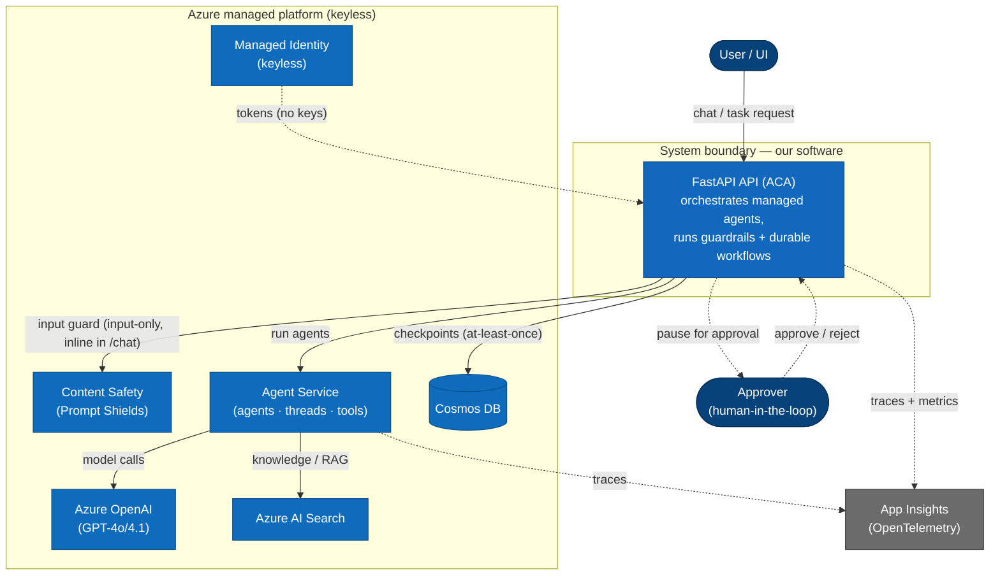

_System context: the User (and an Approver for HITL) interact with our FastAPI API (ACA), which is the only component we build; every downstream capability — Content Safety, Agent Service, Azure OpenAI, AI Search, Cosmos DB, App Insights, Managed Identity — is an Azure managed service._

### C4 L2 — Container

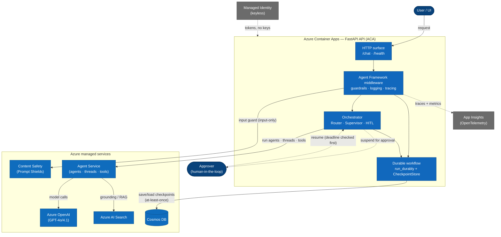

_Container view: inside the ACA boundary the FastAPI HTTP surface fronts the Agent Framework middleware, the durable workflow, and the orchestrator; the middleware runs the input-only guard against Content Safety, the orchestrator drives Agent Service (which calls Azure OpenAI and AI Search), the workflow persists at-least-once checkpoints to Cosmos DB, and Managed Identity supplies keyless tokens._

### C4 L3 — Component (orchestration service)

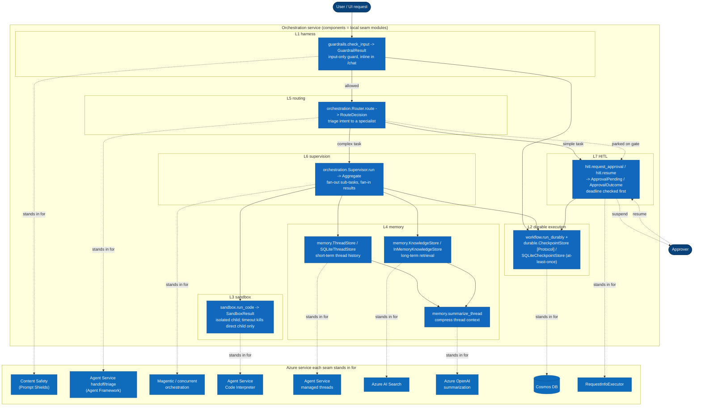

_Component view of the orchestration service: each L1–L7 local seam module (grouped by lesson) is shown with its exact signature and responsibility, wired into the request flow (guard -> route -> supervise/sandbox/memory/HITL over a durable workflow) and mapped by a dashed 'stands in for' edge to the Azure service it will later be swapped for._

## Message sequence diagrams

### /chat request lifecycle (guard → agent tool-loop → trace)

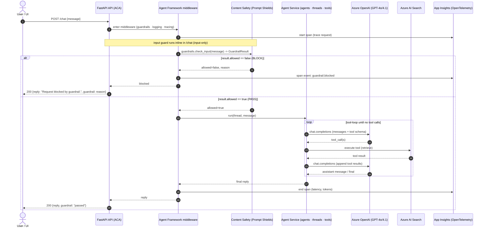

_A /chat request flows through the inline input guard (Content Safety) before the Agent Service runs an Azure OpenAI tool-loop, with spans emitted to App Insights and an alt branch showing a guardrail BLOCK short-circuiting the agent call._

### Durable execution — crash mid-run and at-least-once resume

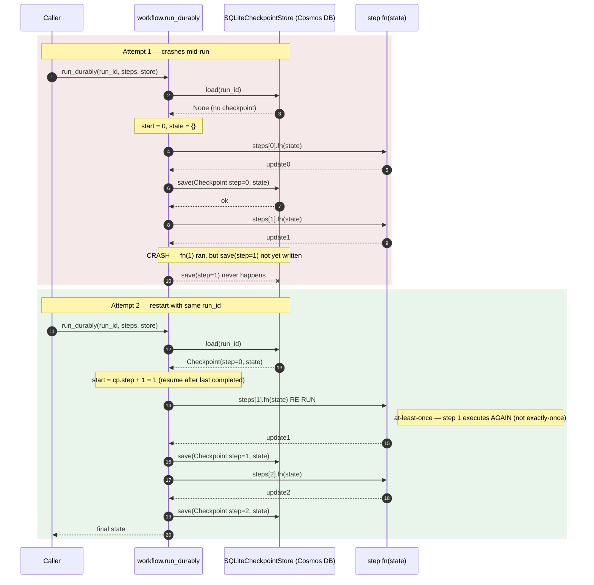

_run_durably saves a checkpoint after each step; a crash between fn(1) and its save leaves step 1 uncommitted, so the restart resumes from step.step+1 and re-runs step 1 — illustrating at-least-once, not exactly-once, execution._

### HITL — park a checkpoint, then resume with deadline-checked-first

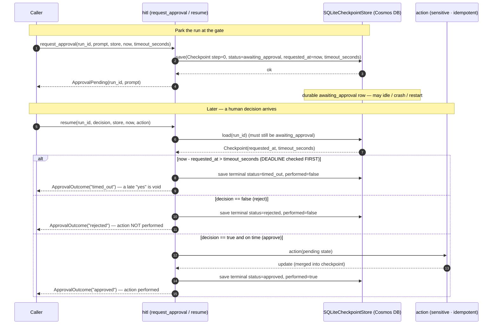

_request_approval persists a single awaiting_approval checkpoint and returns without acting; resume loads it and checks the deadline FIRST (a late yes times out), then handles reject vs approve, running the sensitive action only on an approved, on-time decision._

### Routing handoff — Router.route classifies then hands off with context

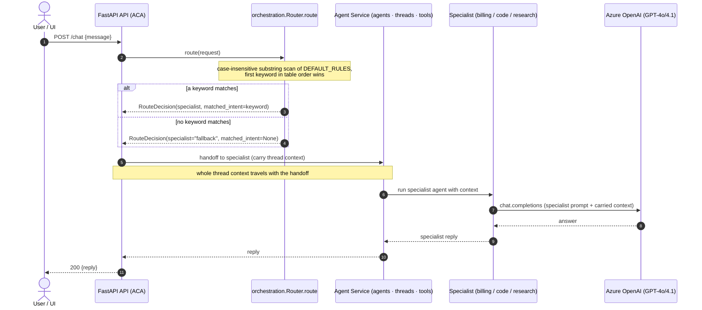

_Router.route does a first-match keyword scan to produce a RouteDecision (or fallback), then the API hands the conversation off to the chosen specialist agent, carrying the full thread context along for the specialist's Azure OpenAI call._

### Supervision — parallel fan-out, fault-isolated fan-in

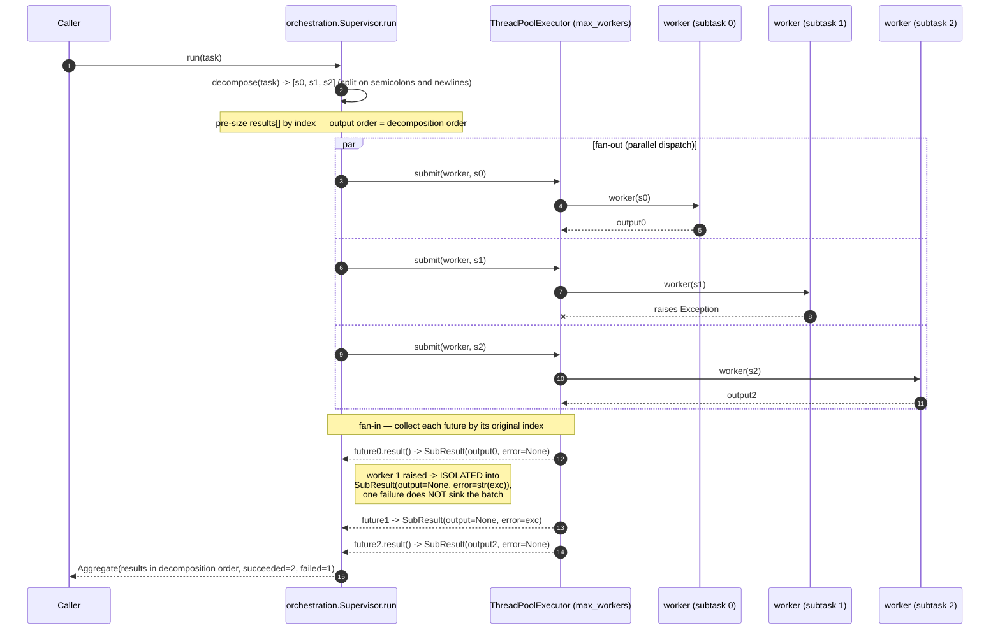

_Supervisor.run decomposes the task, fans the subtasks out across a bounded thread pool, and fans results back in by original index — a worker that raises is isolated into its SubResult.error without sinking the batch, and output order stays independent of completion order._

## State & lifecycle diagrams

### Durable run lifecycle (workflow.run_durably + CheckpointStore)

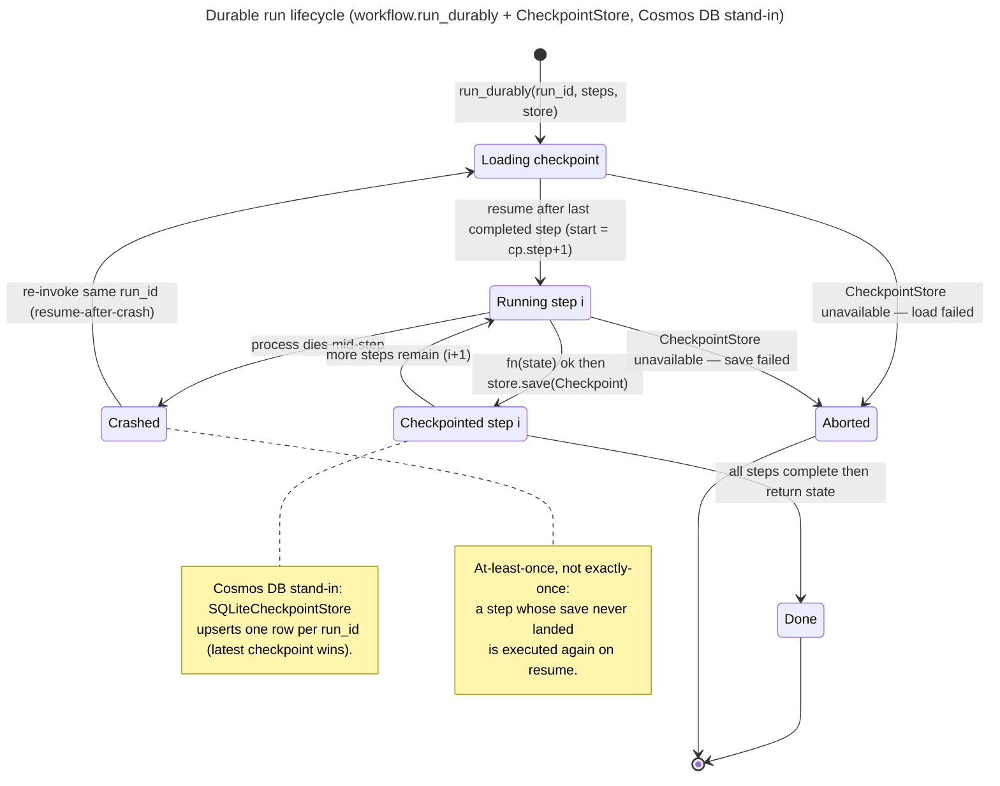

_Lesson 2 durable execution: run_durably checkpoints after each step so a crash resumes from cp.step+1, while a load/save failure on the CheckpointStore (Cosmos DB stand-in) aborts the run — recovery is at-least-once, not exactly-once._

### HITL approval state machine (hitl.request_approval / hitl.resume)

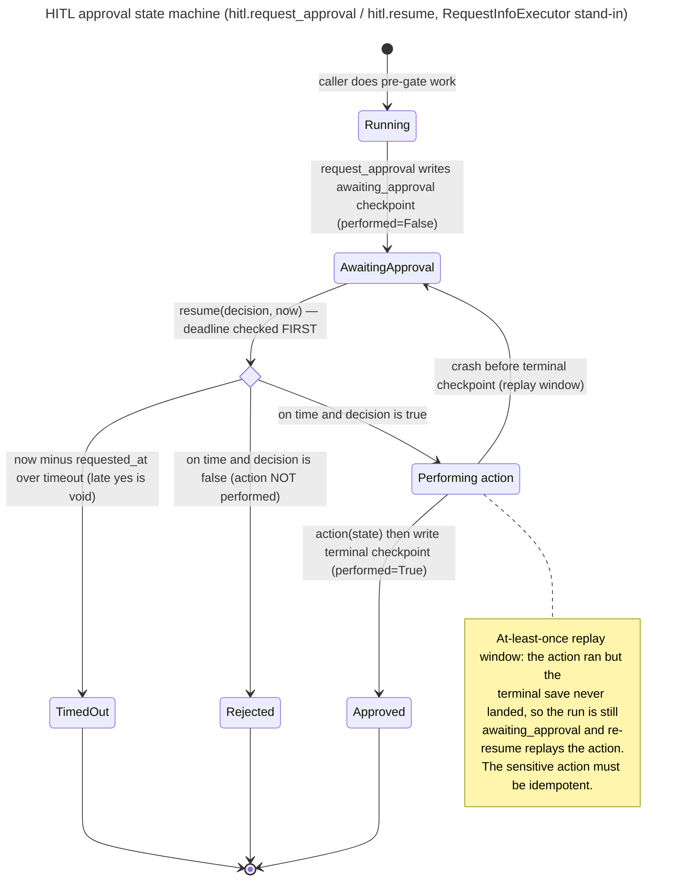

_Lesson 7 human-in-the-loop: request_approval parks the run as awaiting_approval, and resume checks the deadline FIRST (a late yes is void) before branching to Approved / Rejected / TimedOut — a crash between action and terminal checkpoint reopens the at-least-once replay window._

### Single agent run in the harness (input-guarded model/tool loop)

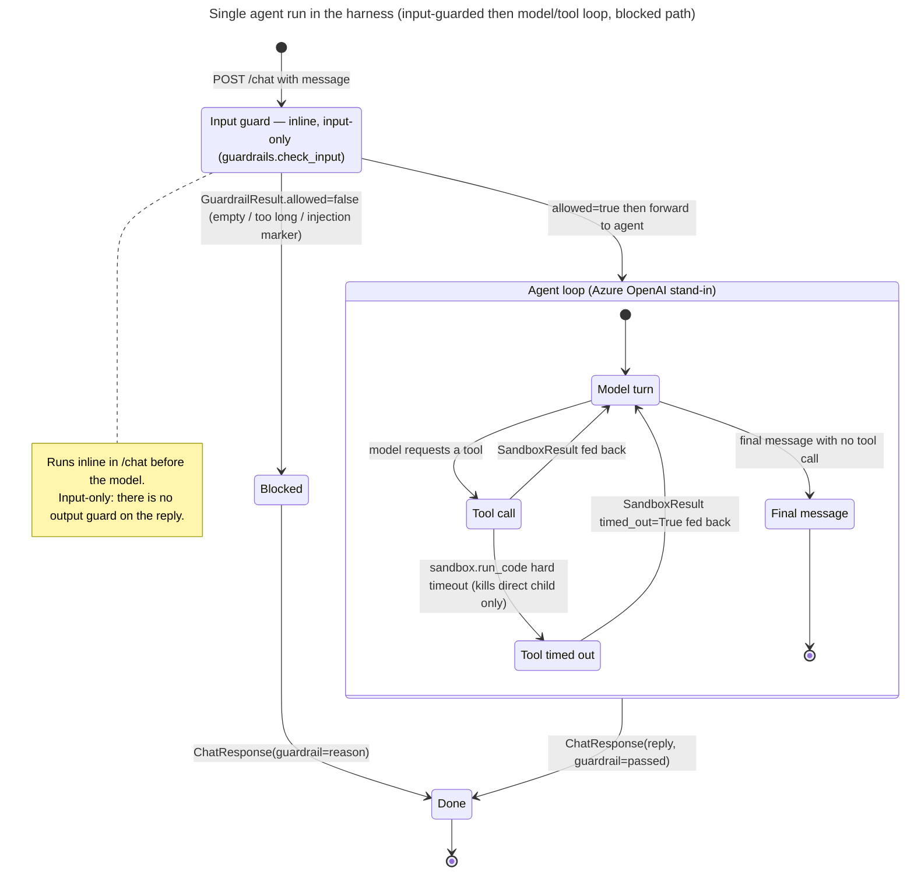

_Lesson 1 harness: /chat runs guardrails.check_input inline (input-only) before the agent; a blocked verdict short-circuits to a guardrail response, while an allowed request enters the model/tool loop where sandbox.run_code timeouts (killing only the direct child) feed a SandboxResult back until a final message ends the run._

## Class / seam diagrams

### Storage seam #1 — CheckpointStore (durable execution + HITL persistence)

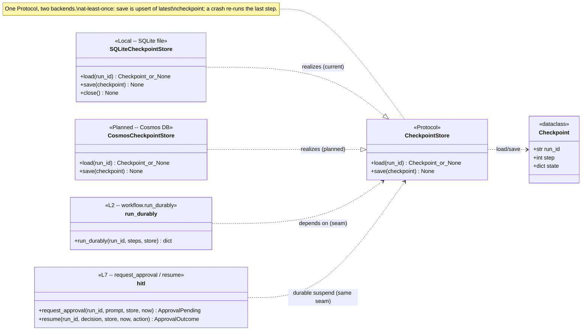

_The CheckpointStore Protocol is one swap point realized by the current SQLiteCheckpointStore and a planned CosmosCheckpointStore (Cosmos DB); both L2 run_durably and L7 hitl ride the same seam, and its at-least-once upsert semantics are why a crash re-runs the last step._

### Storage seams #2 — ThreadStore + KnowledgeStore (memory)

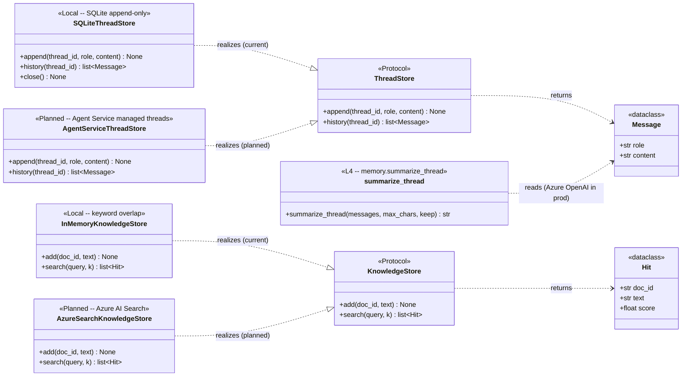

_The two L4 memory Protocols repeat the same seam pattern — ThreadStore (SQLiteThreadStore now, Agent Service managed threads planned) yields Message, KnowledgeStore (InMemoryKnowledgeStore now, Azure AI Search planned) yields Hit — while summarize_thread consumes Message history (Azure OpenAI summarization in production)._

### Behavioral seams — callables/interfaces and their result dataclasses

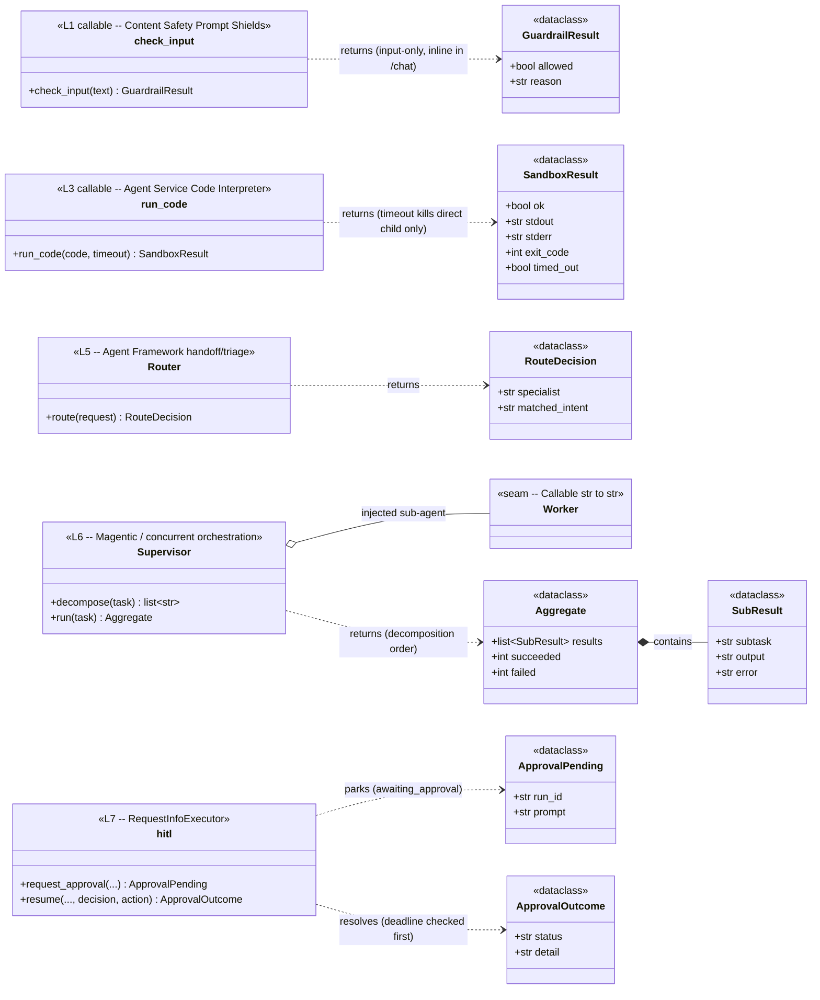

_The behavioral seams as callables/interfaces mapped to their Azure counterparts and value dataclasses: check_input->GuardrailResult (Prompt Shields, input-only inline in /chat), run_code->SandboxResult (Code Interpreter, timeout kills only the direct child), Router->RouteDecision (Agent Framework triage), Supervisor->Aggregate composed of SubResult with an injected Worker (Magentic), and hitl->ApprovalPending/ApprovalOutcome (RequestInfoExecutor, deadline checked first)._

## Data model & mapping

### Persisted local schemas (checkpoints & threads)

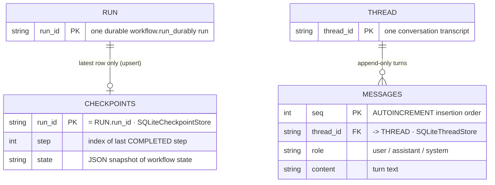

_The two persisted SQLite schemas: one checkpoints row per RUN (upsert keeps only the latest step/state), and an append-only threads table (messages.db) where each MESSAGES row is one turn of a THREAD ordered by AUTOINCREMENT seq._

### Local store to Azure counterpart mapping

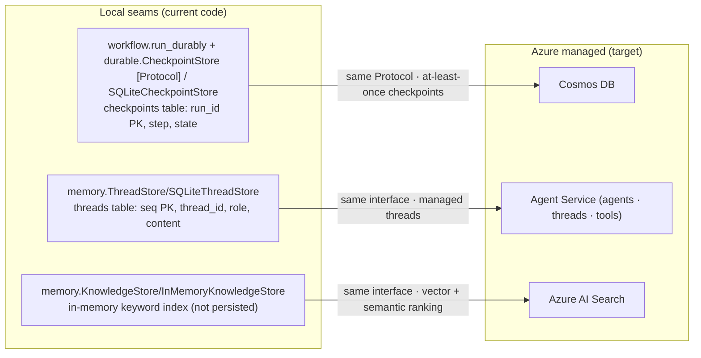

_Each local storage seam is a Protocol swap-point pairing one-to-one with its Azure counterpart: SQLite checkpoints to Cosmos DB, SQLite threads to Agent Service managed threads, and the in-memory knowledge index to Azure AI Search._

## Deployment & data flow

### Azure deployment topology — ACA-hosted harness (keyless + OTel)

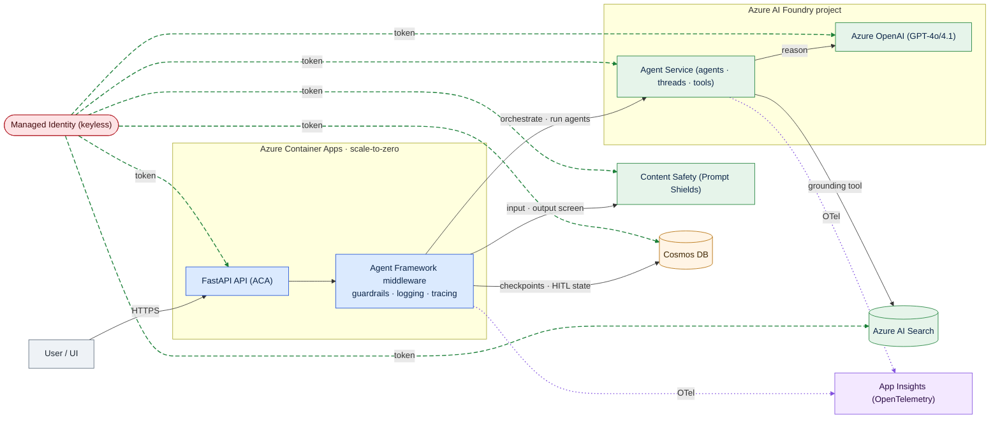

_Scale-to-zero ACA hosts the FastAPI app plus Agent Framework middleware, wired to Foundry Agent Service, Azure OpenAI, Content Safety, Cosmos DB, and AI Search, with Managed Identity issuing keyless tokens (green dashed) and every hop emitting OpenTelemetry traces to App Insights (purple dotted)._

### End-to-end data flow — one guarded, memory-augmented, durable request

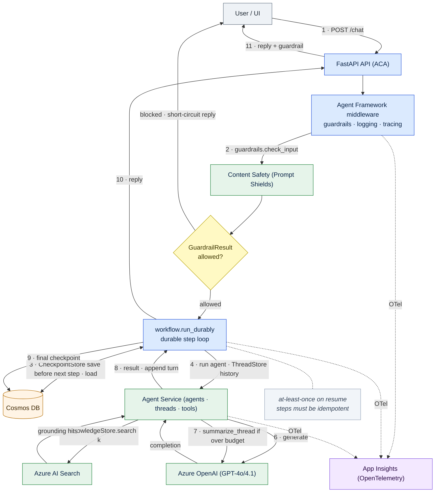

_A single request flows input-first through guardrails.check_input to Content Safety (block short-circuits), then into the durable workflow.run_durably loop that checkpoints to Cosmos before each step, hydrates short-term ThreadStore history and long-term KnowledgeStore.search hits, calls Azure OpenAI (with optional summarize_thread), and returns — every hop traced to App Insights, with at-least-once idempotent semantics on resume._

---

## Editable source

- [`architecture.excalidraw`](architecture.excalidraw) — hand-drawn, draggable architecture canvas (open in excalidraw.com or the VS Code Excalidraw extension).
- Mermaid sources above are the version-controlled diagrams; edit them inline and GitHub re-renders.

