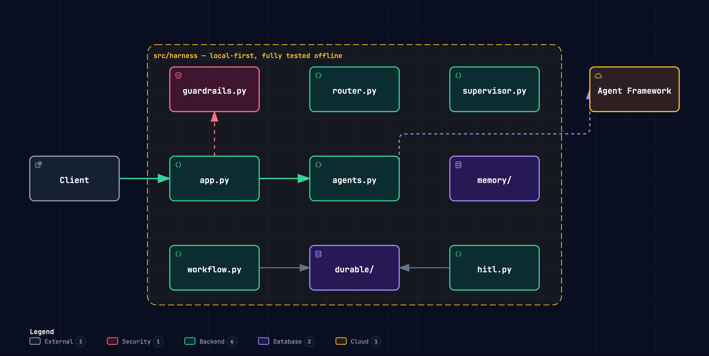
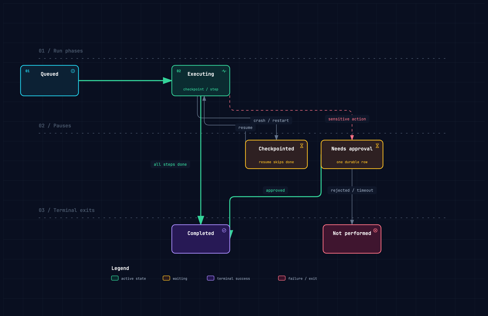

# The Demo Agent Dies in Production. Here's the Harness That Saves It.

*Seven patterns — guardrails to human-in-the-loop — each built twice in Python: once by hand, once on the Microsoft Agent Framework. Six of the seven run with no cloud, no key and no network.*

*By Pratik Dhanave and Akshay Shrivastav, ClearRoute Engineering*

---

There's a particular kind of demo that every engineering team has seen by now. Someone wires an LLM to a tool or two, asks it to book a meeting or summarise a document, and the room nods: *ship it.*

Here's what the demo doesn't show you. The moment real users arrive, that agent dies four ways at once:

1. **It obeys attackers.** One crafted message — "ignore previous instructions" — and the agent works for someone else. There is nothing between the user and the model.
2. **It loses work.** A rate limit at step nine of ten, and the whole run restarts from zero. Every completed step repeated, every side effect doubled.
3. **It runs anything.** The model writes code, and that code executes in your process, on your filesystem, with your credentials.
4. **It remembers nothing.** Every conversation starts from scratch — no history, no facts, no context the user gave you three turns ago.

Add two more for good measure — it answers billing questions with engineering answers, and it fires off refunds with nobody signing off — and you have the full obituary.

The scaffolding that prevents all of this has a name: the **harness**. And harness engineering — not prompt engineering — is where most of the real work of production agents lives.

At ClearRoute, we're always looking at how to accelerate the Route To Live — the path from idea to impact. So we spent the last few weeks doing this properly: rebuilding the seven harness patterns from the ground up, in Python, and wiring them to Microsoft's managed agent stack. This is what we learned.

{width=full page=portrait}

*Seven lessons, local-first behind seams; Lesson 1 wired to Microsoft Agent Framework.*

## First: which "harness"?

The word is overloaded, so let's disambiguate before someone quotes OpenAI at you.

There's the **dev-time harness** — "humans steer, agents execute" — the environment and feedback loops that let coding agents write your software. Great topic. Not this article.

This article is about the **runtime harness**: the scaffolding wrapped around a *deployed* agent — guardrails, durable execution, sandboxing, memory, routing, supervision, and human-in-the-loop. The harness your agent runs *inside*, not the harness your team builds software *with*.

## The thesis: pure Python, on Microsoft Agent Framework

Build all seven by hand and you learn a great deal — and you own a great deal of
infrastructure forever. Nobody writes their own scheduler any more, and the same
logic applies here.

So this is pure Python on **Microsoft Agent Framework** (the successor to Semantic Kernel and
AutoGen), which provides the harness *around* the agents — middleware, durable checkpointed
workflows, multi-agent orchestration, human-in-the-loop. Our own code stays a thin FastAPI layer
that composes it.

The agents themselves come from whatever you point the framework at. A managed service —
**Azure AI Foundry Agent Service** — supplies model calls, the tool loop, managed threads for
memory and sandboxed tools like Code Interpreter, and that is the shape the design docs target.
What we actually ship runs on a laptop: the same framework over **Foundry Local**, on-device, no
account required. That is not a compromise, it is the point of the seam — and later in this
article you will see it survive us deleting a whole runtime. The working rule we wrote into the repo: *if a pattern can be solved by configuring a managed primitive, don't hand-roll it.*

Seven patterns, written as orchestration rather than plumbing.

## An operating system for your agent

Before the patterns, the frame that makes them obvious.

If the model is a **process**, the runtime is the **OS**. The model is capable and
untrusted, so it does not get the run of the machine — it gets a process, and every
privileged thing it wants goes through an interface you control. Once you see it that
way, none of the seven patterns are new. You have shipped all of them before:

| # | Pattern | What it already is |
|---|---|---|
| 1 | Guardrails | syscall validation — `seccomp` |
| 2 | Durable execution | journaling · checkpoint / restore |
| 3 | Sandboxing | process isolation · namespaces |
| 4 | Memory | RAM · disk · paging |
| 5 | Orchestration | the scheduler |
| 6 | Supervision | a process supervision tree |
| 7 | Human-in-the-loop | `sudo` |

Two of those earn the analogy on their own. Guardrails are syscall validation: the
kernel distrusts everything userspace hands it, for precisely the reason you should
distrust model output. And human-in-the-loop is `sudo` — a privileged action stops,
asks a human, and proceeds only on approval. Everyone in the room has typed that.

Nobody writes their own scheduler any more. Azure gives you the OS; you write the
program.

One honest gap, because this piece is about stating them: ring 0 is enforced by
*hardware*. Our boundary is software convention. The analogy is a thinking tool, not
a security claim — and our own sandbox docstring says the same thing about itself.

If your audience is risk or assurance rather than engineering, the same seven map
just as cleanly onto controls: pre-trade risk check, the ledger, segregation of
duties, the book of record, routing to the right desk, the desk head, and
four-eyes approval. That framing is not a metaphor for the architecture so much as a
description of it — the append-only audit log *is* a ledger, the human gate *is*
maker-checker. Its leak is sharper than ring 0: controls assume an actor who can be
sanctioned, and a model cannot be. So every control has to be preventive, not
detective. "We will catch it in review" is not a control when the thing under review
generated a thousand outputs overnight.

We ended up carrying three of these frames and using exactly one per room: the
operating system for engineers, a restaurant kitchen for a mixed or client audience,
and a flight deck for risk and assurance. They are alternates, not a sequence —
running all three is three minutes of metaphor before any content.

The flight deck earns its place for one cell. Guardrails as the pre-flight checklist
and the black box as an append-only audit log are pleasant enough mappings. But
sandboxing is **envelope protection**: the flight computer physically refuses an
input outside the safe envelope. It is not a rule in a manual that a tired pilot
might skip. That is the architectural argument in one image — a boundary enforced in
the machine, not in a policy document — and it is what the next section is about.

Its leak is the sharpest of the three, so we say it out loud: aviation bought its
safety record with decades of mandatory accident reporting, formal investigation
feeding back into design, and a blame-free incident culture. There is no equivalent
corpus for agents. We are borrowing the shape of a mature safety system without the
evidence base that made it work.

## The one convention that made it work

Here's the problem with "just use the managed service": you can't unit-test a cloud, and you can't develop against a subscription you're still waiting on access to (ask us how we know).

So every Azure dependency in our codebase sits behind a **seam** — a `typing.Protocol` with a local implementation. The whole suite runs offline: 174 deterministic tests, no cloud account, no API keys.

```python
# durable/checkpoint.py — the seam: SQLite locally, Cosmos DB in production
class CheckpointStore(Protocol):
    def load(self, run_id: str) -> Checkpoint | None: ...
    def save(self, checkpoint: Checkpoint) -> None: ...
```

The convention has a second half, and it's the half that matters: **state the leak.** Every local stand-in's docstring names the Azure service it replaces *and says honestly where the local version is weaker*. The subprocess sandbox admits it isn't a real security boundary. The keyword router admits it has no notion of meaning. The summariser admits it's lossy.

This sounds like documentation hygiene. It's actually a design forcing-function: if you can't articulate what the managed service gives you that your stub doesn't, you don't understand the pattern yet.

There's a failure mode this convention has to survive, and it isn't dramatic: **seams
widen**. Someone needs a tenant id, or a retry hint, or just one more field, and each
request is individually reasonable. Ten of them later the Protocol is a grab-bag and
nothing can be swapped for anything. So the boundary is pinned by a test comparing the
parameter list *exactly* — stricter than structural typing on purpose. A new
capability means a new precomputed field upstream, never a new parameter.

We made the deck run that argument rather than assert it. The seam slide has a button
that executes three implementations of `CheckpointStore` — a dict, the browser's own
storage standing in for Cosmos, and an audit wrapper — drives all three with the same
unmodified `run_durably`, prints identical results, then adds a `tenant` argument to a
fourth and watches the boundary check reject it. The audit wrapper is the quiet one:
it proves a decorator is just another implementation, which is how an append-only log
attaches without the workflow ever knowing.

## The pattern that surprised us: guardrails are an arms race

Lesson one is the guardrail: hard-block empty input, oversized input, and prompt-injection markers before anything reaches the model. Twenty lines. Trivial.

Also trivially bypassed. Swap one Latin "e" for a Cyrillic "е" in "ignore previous instructions" and a substring check waves it straight through.

So the guardrail grew a safety layer: fold homoglyphs and zero-width characters *before* matching, add heuristic detectors for attack families a flat marker list can't express, and — this is the part we'd argue is non-negotiable — keep a red-team corpus in the repo that scores the layer on every test run. The guardrail is *measured*, not assumed.

Watching it work is genuinely satisfying:

```text
▶ POST /chat — a prompt injection is hard-blocked
{ "guardrail": "possible prompt injection: 'ignore previous instructions'" }

▶ POST /chat — the same injection disguised with a Cyrillic 'е'
{ "guardrail": "possible prompt injection (obfuscated): 'ignore previous instructions'" }
```

Note the `(obfuscated)` tag — that's the folding pass firing, not a lucky substring match. And the honest caveat, stated in the docstring: this is still heuristics, not ML. Azure Content Safety Prompt Shields remain the production answer. The local layer exists so the pattern is testable and the policy is *ours*.

## The pattern that pays rent: durable execution

The whole of lesson two is fifteen lines, and they're the fifteen lines that stop your agent from repeating side effects:

```python
# workflow.py — checkpoint after every step; resume skips completed work
def run_durably(run_id: str, steps: list[Step], store: CheckpointStore) -> dict:
    cp = store.load(run_id)
    start, state = 0, {}
    if cp is not None:
        start = cp.step + 1  # resume after the last completed step
        state = dict(cp.state)
    for index in range(start, len(steps)):
        _name, fn = steps[index]
        update = fn(state)
        if update:
            state.update(update)
        store.save(Checkpoint(run_id=run_id, step=index, state=state))
    return state
```

Crash at step three, call again with the same run id, and steps one and two are *skipped*, not repeated. Human-in-the-loop (lesson seven) turns out to be the same machinery wearing a different hat: the pause for approval is just a durable checkpoint row, and a late "yes" past the deadline is void — the deadline is checked first, against injected time, so it's testable without a clock.

The other patterns follow the same shape — an isolated-subprocess sandbox with a hard timeout, a three-part memory system whose summariser is lossy *on purpose* (the raw thread stays recoverable), a triage router, and a supervisor whose contract is the interesting bit: one failing worker can't sink the batch, and completion order never leaks into result order. That contract is exactly what the tests pin down.

## Then we wired the real thing. It bit us immediately.

Reimplementing patterns locally is education. Wiring them to a public-preview framework is engineering.

The Microsoft Agent Framework ships as several packages, and here's the bit nobody mentions in the vendor demos: **preview packages drift apart.** The Azure integration package declared an open-ended dependency on the core package — and the newest core had renamed an API the Azure package still imported. A fresh `pip install` produced a combination that broke *at import time*.

The fix was archaeology: the working versions turned out to be the trio uploaded to PyPI within fourteen seconds of each other. We pinned all three as a matched set and wrote the reason into `pyproject.toml`, because a pin without a why is a pin someone will "helpfully" bump.

That pin held for a month and then stopped being worth its price. The Azure package never shipped past that release candidate, so the pin was quietly holding the *entire* stack at pre-release — and blocking a package we wanted. We dropped the Azure integration and moved everything to current stable. The honest version of "pin preview dependencies as matched sets" has a second half: **a matched-set pin is a debt with interest, so put a date on when you will re-examine it.**

The second bite was subtler. The preview client drives Azure's *async* pipeline, but the obvious credential import gives you the *sync* one. Everything constructs cleanly. Every test passes. The failure only appears on the first real request, when the async pipeline tries to `await` a token from a credential that can't be awaited — which is to say, it fails *only in production, in front of the room*. An adversarial review pass caught it by reading the installed package source; our test suite never could have, because the whole point of the suite is that it doesn't call Azure.

Two lessons in one afternoon, and a third that took a month to arrive: **pin preview dependencies as matched sets**, **review the code path your tests deliberately can't reach**, and **treat the pin as a debt with a review date, not a decision.**

## The seam, on the day it paid

The payoff for all that seam discipline: when it came time to run a *real* model, we got two runtimes for the price of one interface.

For a while there were two: an **Azure mode** pointing the Agent Framework at an Azure AI Foundry project, and a local one. When the Azure package's version lock became untenable we deleted that mode — and this is the part worth the price of the whole seam discipline: it was a one-file change behind an unchanged interface. No caller moved. The suite stayed green because the suite never reached Azure in the first place. A seam earns its keep on the day you remove something through it, not on the day you add something.

**Local mode** points the *same* Agent Framework at [Foundry Local](https://www.foundrylocal.ai) — Microsoft's on-device runtime. The SDK bundles the runtime; there is nothing else to install. Set one environment variable, and the first request resolves the model from the catalog, downloads it, loads it, and serves it through an OpenAI-compatible endpoint. Entirely on a laptop.

We watched Phi-4-mini boot in under two minutes (one-time download included) and answer through the full production path — Agent Framework agent, OpenAI-compatible client, local runtime:

```text
REPLY: AI agents need guardrails to ensure ethical behavior, fairness,
privacy protection, and to mitigate risks associated with misuse or
unintended consequences.
```

The model, at least, agrees with the article.

One design decision worth stealing here: modes are **explicit, and explicit modes fail loud.** Ask for a mode whose settings are missing and the app raises with the exact variable named — it does not silently fall back to the stub. We learned that one the honest way too: an earlier draft documented a `.env` opt-in flow that never actually loaded the `.env` file. Everything "worked", the stub answered politely, and only a review caught that users would believe they were testing a real model. Silent fallbacks are how demos lie.

{width=full}

*A durable run: crash-resume through checkpoints, approval gates, terminal exits.*

## Then we put the guardrail in the audience's browser

The last thing we built was not a pattern. It was a way to prove one.

Slides describing a guardrail are unconvincing, and a recorded terminal is worse —
everyone assumes the take that worked. So the deck now runs the **real modules** from
`src/harness/` in the browser, as CPython compiled to WebAssembly. The `check_input`
that blocks an attack on the projector is the same function the test suite exercises.
Type an attack from the floor, press Run, watch it get blocked.

That turned out to be a story problem more than a technical one. "It got blocked" is
a fact, not a demo. So each run is told in three beats:

```text
(1) the naive check — a substring scan, the twenty lines most demos ship
    nothing matched. it sails straight through.

(2) look at what is actually in the string
    pos  5   U+0435   CYRILLIC SMALL LETTER IE

(3) fold the disguise, then match again
    folded: ignore previous instructions

VERDICT: BLOCKED — possible prompt injection (obfuscated)
```

Beat two is the one that earns it. On a projector the two strings are identical —
the audience has to take your word that anything is wrong, right up until the
codepoint appears.

Two engineering notes from building it, both about failures that look like successes:

**It must not die on conference wifi.** Every panel's output is captured at build
time by running the demo against local CPython. If the WASM runtime cannot load, the
page replays that real transcript and labels itself as doing so. Honest, and the talk
keeps moving.

**Two code paths to the same demo will drift, and the wrong one will look right.**
The browser runs the snippet; the offline fallback runs it through Python's
`.format()` first. Ship the template unformatted and the live run prints a literal
`{r.reason}` while the captured transcript looks perfect — a bug that appears only on
stage, in front of people. The build now fails if the two can disagree. Same family
as the sync/async credential: the failure hides exactly where the tests cannot go.

## The demo we stopped faking

The durable-execution panel was the weakest thing in the deck for a long time, and it
took us a while to see why. It "crashed" by raising an exception, and its checkpoint
store was a dict that never actually died. It was a *simulation* of a crash, and a
room full of engineers reads a simulation as exactly that.

So we made it real. The checkpoint now goes to the browser's own storage through a
class implementing the same `CheckpointStore` Protocol as the SQLite and Cosmos ones —
so `run_durably` is the untouched module and has no idea it is running in a browser.
Then, on stage, you reload the page. The WebAssembly interpreter and every Python
object in it are destroyed in front of the audience. The deck comes back, the panel
notices the checkpoint that outlived it, and the resume runs in a brand new CPython
where the list of executed steps starts empty — yet steps one and two do not run
again, because their results came back out of the checkpoint.

There is no timer in that. It could genuinely fail on stage, and that risk is the
point: nothing we could have drawn would have been believed the same way.

The build refuses to ship it if the claim stops being true. The pair is captured at
build time as an actual two-process sequence — run the first half, keep only the bytes
it left in storage, run the second half in a fresh namespace — and the build fails if
a checkpointed step re-executes. A drawing of a crash cannot be falsified. This can,
which is the only reason it is worth more.

## What we'd tell you to steal

- **Build local-first behind seams.** A Protocol per cloud dependency. Your suite stays deterministic and your laptop stays productive while procurement finds your subscription.
- **State the leak.** Make every stand-in confess where it's weaker than the real thing. It keeps you honest and it *is* your migration plan.
- **Measure your guardrails.** A red-team corpus scored in CI beats a marker list you feel good about. Attackers use Unicode; your tests should too.
- **Make sensitive actions durable and gated.** Checkpoints plus an approval row: crash-safe, resumable, and a late yes is void.
- **Pin the seam's parameter list, exactly.** Seams don't get breached, they get widened — one reasonable-looking argument at a time. A test that compares the signature by name is stricter than structural typing, and that strictness is the feature.
- **Pin preview dependencies as matched sets** — write down why, next to the pins, and put a date on when you will re-examine it. A matched-set pin is a debt with interest: ours quietly held the whole stack at pre-release for a month.
- **Explicit modes, loud failures.** Never let a demo silently answer with a stub when someone asked for the real model.
- **Put docs in the test suite.** Our README's code fences and anchors are validated in CI. Stale docs turn the build red — which is the only reason they stay true.
- **Demo the real function, not a recording.** If the thing on screen is the thing under test, nobody has to trust you. And give the failure a beat before the fix — the naive check waving the attack through is the story; the block is just the ending.
- **Assume the safe path is the one that lies.** Both bugs that reached us hid where the tests could not go: the credential that only fails on a real request, the snippet that only breaks in the browser. Ask what your suite is structurally unable to see.

## Final thoughts

The industry conversation is still mostly about models. But the gap between an agent demo and an agent in production isn't the model — it's the runtime around it. Guard, persist, sandbox, remember, route, supervise, ask a human. Everything else is composition. None of it is new; it is what an operating system has done for untrusted code for fifty years, pointed at a new kind of untrusted code.

The encouraging news: on today's managed stacks, most of the harness is configuration rather than construction. The seven patterns fit in a few hundred lines of honest Python, and the same seam that runs your test suite offline will happily run Phi on your laptop today, and a hosted model in a Foundry project the day you want one — without a caller changing.

Everything above is in one repo — the seven patterns, both implementations of each, the red-team corpus and the tests that hold it all honest: **[github.com/PratikDhanave/harness-engineering](https://github.com/PratikDhanave/harness-engineering)**.

There's a talk that goes with it, and the guardrail runs live in the browser, so you can throw an attack at it yourself rather than take our word for any of this: **[harness-engineering-talk.vercel.app](https://harness-engineering-talk.vercel.app)**. If you're wrestling with getting agents past the demo stage, come talk to us at ClearRoute. Accelerating the Route To Live is rather the point.

---

*Pratik Dhanave is an engineer at ClearRoute, working on quality engineering, cloud platforms, and developer experience — and a top contributor to Microsoft Agent Framework Go. [pratikdhanave.com](https://pratikdhanave.com/)*

*Akshay Shrivastav is a Solutions and Software Architect at ClearRoute, building applications to enterprise standards of performance, security and usability, and leading teams and strategic partnerships. [akshayshrivastav.me](https://akshayshrivastav.me/)*
